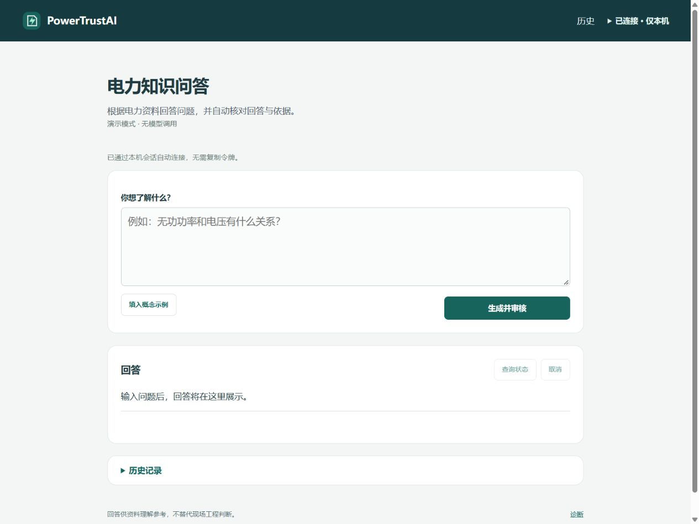

# PowerTrustAI

PowerTrustAI 根据电力资料回答问题，标出需要核实的句子，并让你查看对应原文。

这是单用户本机研究原型：你可以先读回答，再检查审核标注、引用与原文。审核也可能失败或漏错，回答不能替代现场工程判断。

## 先试零模型演示

需要 **Windows、Python 3.13 和 Git**。以下命令在 PowerShell 中运行；不需要 DeepSeek 密钥、私有知识库或模型权重。安装依赖需要联网，演示本身不调用模型。

```powershell
git clone https://github.com/7556481/PowerTrustAI.git
cd PowerTrustAI
py -3.13 -m venv .venv
.\.venv\Scripts\python.exe -m pip install -r requirements.txt
.\start-powertrustai.cmd --demo
```

保持终端运行，打开 <http://127.0.0.1:8766/fixture/connect>。页面会标记“演示模式 · 无模型调用”。8766需空闲；也可运行 `.\.venv\Scripts\python.exe -m tools.ui_fixture --port 8788`，使用对应端口的 `/fixture/connect`。按 Ctrl+C 停止演示。

试一遍：输入“无功支撑与电压有什么关系？”并提交 → 阅读合成回答 → 等待审核标注 → 点标注查看解释与来源原文。再打开历史中的“一次修订与版本1/2”，比较两个版本。演示数据是固定合成案例，不是模型推理或电力知识正确性的证明。



## 使用真实资料

已有本机部署日常双击 `start-powertrustai.cmd`，或在项目目录运行 `.\start-powertrustai.cmd`。真实提交会产生付费调用。新克隆不会附带以下私有材料：

- 固定版本的 SQLite 全文知识库及对应发布清单、知识版本配置。
- 本机受管启动配置、服务访问令牌及需要保留的历史 Store。
- 服务端 DeepSeek 配置：按 [.env.example](.env.example) 在本机设置 `DEEPSEEK_API_KEY` 和 `DEEPSEEK_MODEL_ID=deepseek-flash`；已有环境变量优先，不要提交真实密钥。

安装与可选依赖见 [requirements/](requirements/README.md)，本机配置与回退步骤见[运维章节](docs/learning/chapters/18-operations.md)。本机已验收配置使用 **SQLite 全文检索＋事实审核与领域检索重叠**；通用未配置入口仍用普通 Factory。调度回退入口为 `rollback-overlap.cmd`，保留原历史和预算。

## 它怎样工作

SQLite 检索提供带来源版本和原文范围的 Evidence。四项 Agent 职责依次是生成回答、事实及原引用审核、领域审核、有据修订；主张提取是辅助服务。事实与领域审核可并行，满足资格时最多修订一次，再重新提取并完整双审。

LangGraph 驱动既有阶段路由；Harness 管理预算、取消、生命周期及确定性处置。Store 保存回答版本、证据、审核结果和历史。引用能回查，只证明原文身份可查，不保证原文支持回答。

## 开发、学习与评测

```powershell
.\.venv\Scripts\python.exe -m pip install -r requirements/public.txt
# 完整公共离线检查还需要 Node.js 22；不发模型请求
.\.venv\Scripts\python.exe -m tools.public_checks
.\.venv\Scripts\python.exe -m harness.demo
```

- [中文学习站](docs/learning/index.md)：双击 `start-learning.cmd`，阅读架构、源码、失败分析与面试练习。
- [公开合成案例](docs/portfolio/README.md)与[文档索引](docs/documentation-index.md)：查看可复现的工程检查。
- [评测与退役记录](docs/maintenance/tantivy-retirement-public-v30.md)：区分读取速度与用户等待，保留固定历史报告入口。
- [维护与发布路线](docs/maintenance/repository-mainline-v31.md)：分支、依赖消费者及兼容代码的维护约定。

私有数据、模型输入输出和历史实验结果不随 Git 分发；公开案例不是专家金标准。
