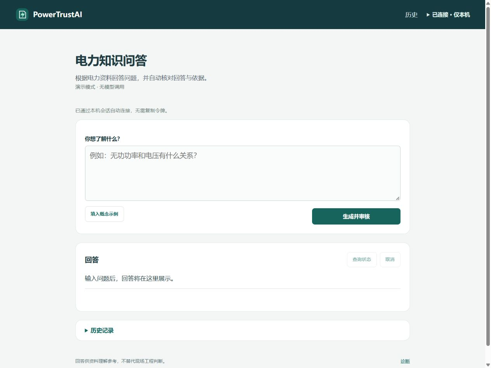
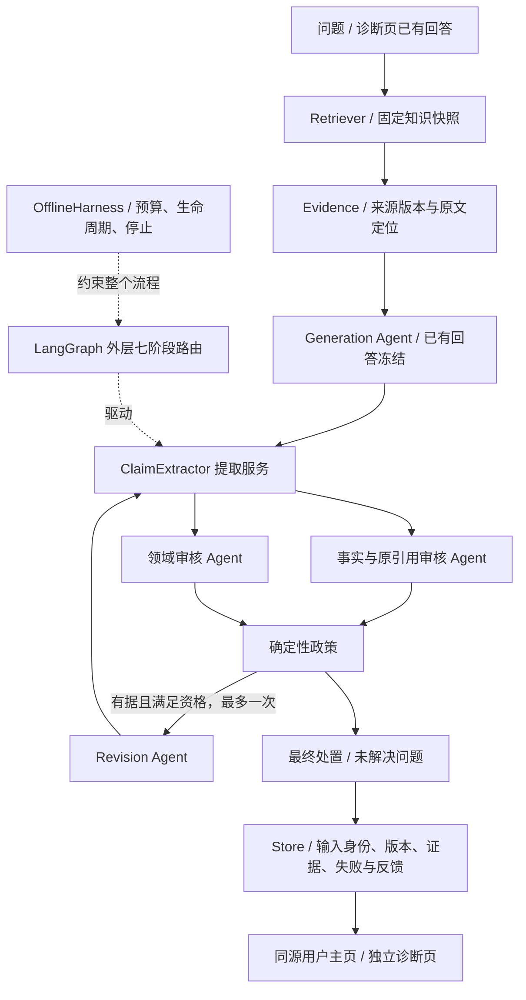

# PowerTrustAI

**电力知识问答与有据审核的本机研究原型。** 根据电力资料回答问题，保留引用、回答版本、审核发现和修订记录，帮助使用者理解“依据是什么、哪些内容仍待核对”。适合电力资料学习和 Agent 工程研究；目前为单用户本机应用，尚未证明稳定纠错能力。

## 使用流程

输入问题 → 先阅读初稿 → 等待自动审核 → 查看结果与引用依据。出现修订时可切换原回答与修订后版本；历史按需打开。令牌连接、已有回答审核、工程背景、逐项发现、NLI、轨迹及追加反馈统一放在独立诊断页。

当前整理分支为 `codex/stable-product-baseline-v1`，**仍为待验收候选，尚未发布到默认分支**。完整离线回归、真实入口启动及UI缺项补验已通过；十题真实基线已完成：6题审核执行完整，2题较可用但仍需限定，4题部分帮助、3题未回答、1题关键条件错误。见[十题结果](docs/evaluation/stable-product-baseline-v1/report.md)。见[验收状态](docs/maintenance/stable-product-baseline-v1.md)与[操作清单](docs/stable-operation-checklist.md)。



上图来自交付分支的真实浏览器截图，合成演示仅展示交互，不代表真实回答质量。

## 零模型本地演示

新克隆需要 Python 3.13、Node.js（运行客户端测试时使用）及下列公开依赖，不需要密钥、知识大库或模型权重：

```powershell
git clone https://github.com/7556481/PowerTrustAI.git
cd PowerTrustAI
git switch codex/stable-product-baseline-v1
python -m venv .venv
.\.venv\Scripts\python.exe -m pip install -r requirements-api.lock.txt -r requirements-corpus.txt -r requirements-pdf.txt -r requirements-ci.txt
.\.venv\Scripts\python.exe -m tools.ui_fixture --port 8766
```

已有项目环境可直接运行 `./start-powertrustai.cmd --demo`（复用上述合成演示入口）。打开 [合成演示连接入口](http://127.0.0.1:8766/fixture/connect)，建立正常本机会话后进入主页。页面明确标记“演示模式 · 无模型调用”；假答案只验证交互，不作为模型质量证据。关闭该命令即可停止本次演示。8766 被占用时换空闲端口，勿占用真实服务8765。

只看学习资料可运行 `python -m tools.learning_site serve --port 8770`，或双击 [start-learning.cmd](start-learning.cmd)。[中文学习站](docs/learning/index.md)包含架构、算法手算、源码导读、失败分析和面试练习；N1 → A3 → N4 路线展示历史资料交付、给定发现后修订及自然审核漏错。

真实运行使用 [start-powertrustai.cmd](start-powertrustai.cmd)，需要服务端私有配置、固定知识快照与凭据，提交会产生付费调用。新增真实请求仅使用已授权的 DeepSeek Flash；公开演示不会切换到真实适配器。私有材料与实际运行输出不随 Git 分发。

## 实际架构



事实与领域审核在既有链路中并行，修订后重新提取并完整双审。四 Agent 分担生成、事实、领域和修订；ClaimExtractor 是服务，LangGraph 不是第五个 Master。受管运行使用 LangGraph，未配置源码入口可使用 sequential；二者复用 Harness 与阶段实现，不另建调度器。研究候选和历史 NLI 诊断不等于生产默认启用。

## 关键工程设计

- **可回查**：Evidence、文档版本、原文区间及回答引用严格绑定；可定位只证明来源可查，不证明语义支持。
- **有限闭环**：共享预算、超时、取消及失败停止；有据修订至多一次，保存原回答并完整重审。
- **故障与历史分离**：服务拒单或保存未确认时明确提示，保留已存业务结论，不自动重启、重放或重发未知 POST。
- **请求归属**：旧请求和旧鉴权错误不能覆盖新任务；反馈按实际回答版本与发现追加，保留 AI 辅助、用户监督来源。

## 证据与限制

|已见固定材料|结果|解释边界|
|---|---|---|
|8题、A/C两组共16份生成|5题净改善、3题混合；正确完整语义槽1/25 → 19/25|资料变化后的生成收益；没有B回答组，不能全归查询转换|
|给定成立发现的历史修订|4/4实际修改并完整重审|不是自主发现率，也不是自然审核收益|
|8份自然C稿新审核|N2/N4关键问题未纠正；19/25不变；N8局部改写有争议，N5执行失败|关键纠错收益未证；pass不代表工程安全认证|

[生成诊断与16回答](https://github.com/7556481/PowerTrustAI/blob/a6ba66d4787e2806d828edd84ec6435cc6e2d64f/docs/evaluation/retrieval-evidence-answer-check-v1/report.md) · [给定发现后修订4/4](https://github.com/7556481/PowerTrustAI/blob/73c25ca0af9ba9fd5143527c6341aae52170fffd/docs/evaluation/local-revision-v2-flash-check-v1/report.md) · [自然审核失败](https://github.com/7556481/PowerTrustAI/blob/865eb65c617e14c04d443283bec8b27af1da0f14/docs/evaluation/natural-draft-audit-v1/report.md)。这些是小规模已见开发材料、AI辅助和用户监督复核，不是专家金标准或独立留出准确率。

私有约70GB资料采用 FTS 倒排索引，不是全量向量库；资料在库仍可能无法召回。原出处、PDF提取质量和模型支持关系判断均有限制。审核包含提取、双审、可能的结构纠正及修订后重审，延迟仍可能较长；本轮未证明推理提速。回答供资料理解参考，不替代现场工程判断。

## 开发与文档

```powershell
# 离线Fake测试，不发模型请求
.\.venv\Scripts\python.exe -m unittest discover -s tests -v
# 公开克隆检查：缺失私有历史会明确跳过，公开合成检查必须执行
.\.venv\Scripts\python.exe -m tools.public_checks
```

[学习与面试手册入口](docs/learning/index.md) · [文档索引](docs/documentation-index.md) · [设计依据](docs/design-decisions.md) · [项目状态与能力边界](https://github.com/7556481/PowerTrustAI/blob/653412642dc065c39ed6721a64dd55303c45be6b/docs/project-status-20261027.md) · [历史README快照](docs/archive/README-before-ui-v6-20261027.md)。维护进展统一写入交接和专题报告，首页保持产品与架构总览。
