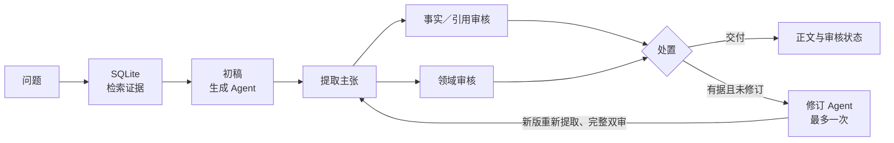

# PowerTrustAI · 电力资料问答与自动审核

PowerTrustAI 根据电力资料回答问题，在正文中标出需要核实的句子，并让用户查看对应原文。它面向电力概念和文献解释：用户既能读到回答，也能看到哪些说法缺少依据、哪些结论需要补充适用条件。

系统先通过 SQLite 全文检索取得资料，由生成 Agent 写出初稿。事实审核核对回答与引用，领域审核检查适用条件和工程前提。有明确依据时，系统最多修订一次，再对新版完整复核。每一版回答都保留自己的引用和审核记录。

- **阶段与控制分开**：LangGraph 编排阶段，Harness 管预算、取消和停止。图中是职责与路由，不是固定次数的串行模型调用；事实与领域审核可并行，本机受管配置还让事实审核与领域检索重叠。
- **依据跟随回答版本**：Store 保存回答、引用和审核记录；引用绑定具体回答版本、来源版本及原文范围，因此打开旧答案仍能查到当时的依据。

## 顺着一次请求读代码

从日常启动入口往下读，可依次找到装配、检索、审核和保存的位置：

1. [tools/managed_overlap.py](tools/managed_overlap.py)：`start-powertrustai.cmd` 从这里选择受管 Factory，创建 API 服务；显式配置可启用 overlap，通用默认仍为普通 Factory。
2. [backend/assembly.py](backend/assembly.py)：`ComponentFactory` 将检索器、四项 Agent 职责、主张提取和 Harness 装配为一次任务的组件。
3. [rag/retriever.py](rag/retriever.py)：查看 SQLite 检索如何返回 Evidence，以及如何校验固定知识版本、回查原文和读取邻接段。
4. [harness/graph_runtime_v1.py](harness/graph_runtime_v1.py)：看 LangGraph 如何连接生成、提取、双审、处置和修订，并将新版送回提取阶段。
5. [harness/execution.py](harness/execution.py)：看各阶段实际执行、双审与检索重叠、预算检查和最多一次修订的边界；审核失败不能算审核完整。
6. [backend/store.py](backend/store.py)：看回答版本、证据和意见如何保存，以及历史意见如何按回答 ID 与版本校验绑定。

## 试用、评测与开发

这是单用户本机研究原型。自动审核会漏错，**自然问答中的自动纠错收益仍待验证**；引用可回查也不代表原文一定支持结论，回答不能替代工程判断。

- [查看界面与试用步骤](docs/demo.md)：零模型演示的完整安装、端口、操作与截图；真实模式所需私有资料和 DeepSeek 配置另列。
- [正式产品十题基线](docs/evaluation/stable-product-baseline-v1/report.md)：真实问答与审核效果、失败和局限；6/10 审核完整，未观察到有据修订，不把执行完整率当作答案可用率。
- [中文学习站](docs/learning/index.md)：双击 `start-learning.cmd`，从源码解释读到面试练习。
- [开发与文档索引](docs/documentation-index.md)及[依赖说明](requirements/README.md)：离线验证、运维与固定历史报告；检索研究、资产退役和分支维护从索引查阅。

已配置环境的零模型演示：`.\start-powertrustai.cmd --demo`；日常真实模式：`.\start-powertrustai.cmd`。
