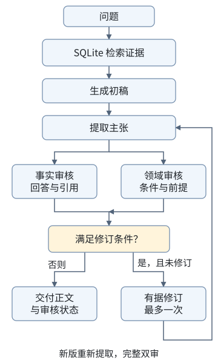

# PowerTrustAI · 电力资料问答与自动审核

## 项目简介

PowerTrustAI 根据电力资料回答问题，在正文中标出需要核实的句子，并让用户查看对应原文。

面向电力概念和文献解释，用户可以一起查看回答、句旁的审核意见，以及每个回答版本对应的引用和原文。自动审核会漏错，回答不能替代工程判断。

## 审核示例

**回答原句**：把并联电力电容器和同步调相机称为“最典型的两种”。 
**审核意见**：资料支持它们是“两种常见装置”，但未提供足以支持“最典型”的比较依据；疑点在比较用语，不在设备名称。 
**本次结果**：系统标出原句并解释原因，正文未修改。

## 系统架构

  

- **连接工作阶段并控制执行**：LangGraph 负责阶段路由；Harness 负责预算、取消和停止，不把四项 Agent 职责当作四次必经的串行调用。[阶段编排](harness/graph_runtime_v1.py) · [执行控制](harness/execution.py)
- **为回答提供可定位的资料**：SQLite 全文检索返回带来源、版本和字符范围的证据，支持原文及邻接段回查。[检索与回查](rag/retriever.py)
- **区分依据问题与工程前提**：事实审核核对回答与引用是否有据；领域审核检查适用条件和工程前提。完整审核发现有明确依据、符合修订资格的问题时，最多修订一次，再对新版完整双审；资料不足以作结论时保留缺口，不拼凑结论。[审核与修订政策](harness/product_policy.py)
- **让旧答案保留当时的依据**：Store 按回答 ID 和版本保存正文、引用及意见；查看历史版本时不会套用新版审核。[版本保存](backend/store.py)

## 体验与文档

[当前状态](docs/current-status.md)：已发布配置、启动入口和能力边界；实时运行看本机健康检查。

- [界面与试用步骤](docs/demo.md)：零模型演示的安装、端口、操作和截图，以及真实模式所需资料与 DeepSeek 配置。
- [正式产品十题基线](docs/evaluation/stable-product-baseline-v1/report.md)：在十道真实问题中，六道完成了完整审核，本批没有触发有据修订。
- [中文学习站](docs/learning/index.md)：架构、源码解释和面试练习；本机可双击 `start-learning.cmd`。
- [开发与文档索引](docs/documentation-index.md)：依赖、启动装配、配置和运维说明，以及固定研究报告。

已配置环境的零模型演示：`.\start-powertrustai.cmd --demo`；日常启动：`.\start-powertrustai.cmd`。
