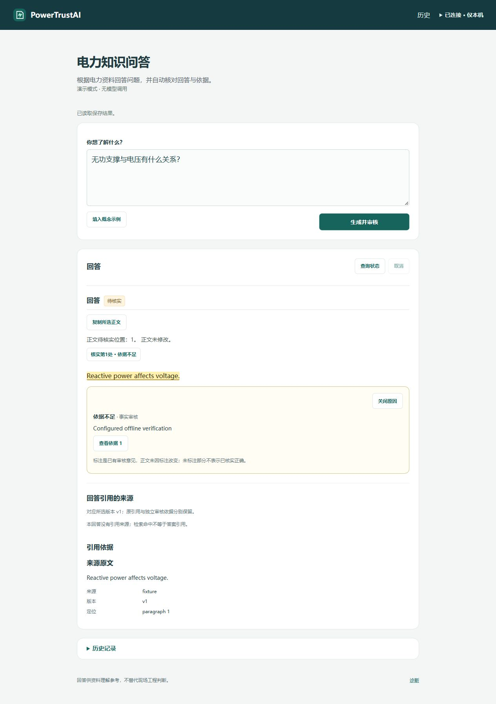

# 界面演示与试用步骤

[返回项目首页](../README.md)

## 先试零模型演示

需要 **Windows、Python 3.13 和 Git**。以下命令在 PowerShell 中运行；不需要 DeepSeek 密钥、私有知识库或模型权重。安装依赖需要联网，演示本身不调用模型。

```powershell
git clone https://github.com/7556481/PowerTrustAI.git
cd PowerTrustAI
py -3.13 -m venv .venv
.\.venv\Scripts\python.exe -m pip install -r requirements.txt
.\start-powertrustai.cmd --demo
```

保持终端运行，打开 <http://127.0.0.1:8766/fixture/connect>。页面会标记“演示模式 · 无模型调用”。8766需空闲；也可运行 `.\.venv\Scripts\python.exe -m tools.ui_fixture --port 8788`，使用对应端口的 `/fixture/connect`。按 Ctrl+C 停止演示。

试一遍：输入“无功支撑与电压有什么关系？”并提交，阅读合成回答并等待审核结束。再从历史打开“资料待补充” → 点“核实第1处”看审核标注 → 点“查看依据”读来源原文。打开“一次修订与版本1/2”可比较两个版本，选择v1查看其原引用；历史版本不会叠加最新版标注。演示数据是固定合成案例，不是模型推理或电力知识正确性的证明。



## 使用真实资料

已有本机部署日常双击 `start-powertrustai.cmd`，或在项目目录运行 `.\start-powertrustai.cmd`。真实提交会产生付费调用。新克隆不会附带以下私有材料：

- 固定版本的 SQLite 全文知识库及对应发布清单、知识版本配置。
- 本机受管启动配置、服务访问令牌及需要保留的历史 Store。
- 服务端 DeepSeek 配置：按 [.env.example](../.env.example) 在本机设置 `DEEPSEEK_API_KEY` 和 `DEEPSEEK_MODEL_ID=deepseek-flash`；已有环境变量优先，不要提交真实密钥。

安装与可选依赖见 [requirements/](../requirements/README.md)，本机配置与回退步骤见[运维章节](learning/chapters/18-operations.md)。本机已验收配置使用 **SQLite 全文检索＋事实审核与领域检索重叠**；通用未配置入口仍用普通 Factory。调度回退入口为 `rollback-overlap.cmd`，保留原历史和预算。


## 开发验证

```powershell
.\.venv\Scripts\python.exe -m pip install -r requirements/public.txt
# 完整公共离线检查还需要 Node.js 22；不发模型请求
.\.venv\Scripts\python.exe -m tools.public_checks
.\.venv\Scripts\python.exe -m harness.demo
```

依赖按需安装与维护入口见 [依赖说明](../requirements/README.md)和[文档索引](documentation-index.md)。
