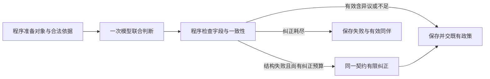

# 事实审核v2：消息契约审计与内部设计比较

本轮只做候选实现、离线验证及真实复验准备，0真实调用。起始HEAD为51c805f94a68cd95b70b21707503c43610592db8。上一批[原始结果](../fact-internal-flow-v1/live-report-v1.md)、输入、参考标签、预测及attempt不改；不切生产，也不恢复旧批。开发候选与schema13生产入口分离。

## 实际消息与契约审计

审计对象是上一批私有messages/response归档及公开原文，并沿当前请求链核对：FactFlowAgent → scoped_fact_execution.execute → structured_request → 适配器。离线测试在适配器边界检查实际system/user/correction消息，而不是只读提示常量。

|位置|发现|v2处理|
|---|---|---|
|v1 SYSTEM = BASE_SYSTEM +追加指令|BASE要求EXACT字段含objection，并完整解释旧对象；后文又禁止objection、要求classification_objection/fidelity。不是一个旧few-shot示例，而是直接冲突的字段规范；F03首响应确实多出objection|v2独立指令，不拼旧SYSTEM；载荷唯一response_schema列出13个必填字段，拒绝额外字段。旧内部投影仍可用objection但不向模型暴露为输出字段|
|repair/comparison等nullable必填项|v1解析要求存在；提示说明分散、没有统一可检查字段表。F04/F05首次缺repair|所有nullable项明确“必填，未用填null”；初始及纠正用同一response_schema函数。不由程序补null绕过解析|
|原通用纠正指令|“ID-only…never copy text”与answer_quote/operand.quote需摘录字面原文存在歧义，虽后句说遵从原字段|候选独立纠正指令区分ID选择和明确允许/要求的文本字段；旧路径默认文本原样保留|
|F04条件声明|required=true,preserved=true但answer_quote为空，v1最终降级不足|v2报preserved_requires_literal_carrier，允许一次纠正；不从回答自动挑片段。若确实缺条件可false/空串，若不确定可null；这两种是有效语义结果|
|F05内容与处置|两次均未提分类异议；第二次题设转述仅正文，最终失败|保留内容supported与对象review_required两层；原文忠实独立。程序不凭“规则”等关键词改分类，不把失败占位当异议成功|
|ordinary逃逸|v1此种类不适用候选依赖检查，技术对象可能借此绕过|v2要求technical_fact/input_evidence_coverage显式选择对象种类；若确实认为应为ordinary，必须给独立分类异议并转复核。普通非技术义务及引用仍可ordinary|

以上是可核对的冲突及风险，不证明它们是模型错误的唯一原因。v2依然可能遗漏字段、误分类、错选依据，正确字段不保证正确理解。历史失败原文用于解析审计，不能计作新模型预测或语义正确率。

## 两种内部设计

|方案|职责与输入输出|潜在收益|成本与风险|
|---|---|---|---|
|A：一次联合判断（本轮实现）|程序准备对象/合法ID；模型同次给对象种类、独立分类异议/忠实性、实际依赖、支持/条件；程序校验后沿既有政策投影|不重复送完整回答/证据；分类和完整支持可相互检查；先去除已证实的契约冲突|语义仍耦合，模型可能为满足支持结构选错对象；字段一致不代表语义一致|
|B：对象与审核义务独立确认（本轮仅比较）|第一调用读取完整回答、提取对象、题设/证据目录，输出拟议义务、相关依赖与异议；程序核对ID，第二调用判断完整支持；第二步仍可记录对象异议，不能把第一步当真值|可分别观察分类与支持错误，给第二步较窄的契约；异议不会被最终支持字段掩盖|每事实组增加一次初始调用，需重复必要上下文；第一步错误可能锚定第二步；新阶段失败/部分保留语义增加；不能因分类未定就少审或提前记成功|

设事实组为1，原引用组数C。A初始1+C，既有事实审核共享最多一次纠正，正常上界2+C。B初始2+C，若仍共享一次纠正，上界3+C；若为每阶段各给一次纠正就是4+C且扩大预算，本轮不采用。补检/修订仍由外层已有阶段另计。无引用的本轮材料A为1或2调用；B为2或3调用，不应伪称固定省token。语义分类错误在一致契约下仍频繁发生且独立分步在同一固定分母上改善完整支持/异议、足以抵偿新增调用和时延后，才值得实现和真实比较B；当前没有此证据。

因此选择先实施A的v2。不是认定联合更优，也不拿尚未实现的B称已验证收益。没有新Master、规划调用、图层重发或按关键词分类。

## 实现与回退

显式开发入口：`services.fact_flow_protocol_v2.create_agent(adapter, ModelSettings(...))`。返回原FactFlowAgent，复用同一四节点图、证据目录、解析投影、作用域隔离、预算和诊断。生产Factory、API配置及默认值不新增v2开关；原`langgraph_candidate_v1`仍是原版候选。退回开发v1直接用原FactFlowAgent；生产保持原schema13即可，无数据迁移。

新增：`services/fact_flow_protocol_v2.py`仅新指令/字段规范/一致性门禁/开发装配；`tests/test_fact_flow_v2.py`验证真实消息及门禁；`evaluation/fact_internal_flow_materials_v2.py`仅离线准备，无execute或真实适配器创建。复用：v1 Catalog、FactFlowAgent、scoped_fact_execution、structured_request。后四者只增加版本/指令参数接口，v1默认消息和行为兼容。暂留：旧生产、v1实现/历史协议、付费入口/冻结与归档。未复制Agent/Harness、数据库、项目或ZIP。

相关性、原文忠实、分类、条件是否必要、单位/因果和全命题支持仍由模型判。程序只约束显式字段之间可判定的关系，不补理由、条件片段、依赖或标签。新增条件门禁可能增加结构失败及纠正，须单独计数，不能以其拒绝更多结果声称语义改善。

## 离线与下一次复验

见[复验计划](revalidation-plan-v1.md)、[完整固定输入与独立参考](inputs-and-reference-v1.json)、[初始消息身份和顺序](preparation-v1.json)、[准备源码身份](source-manifest-v1.json)。只复用已接受的合成开发材料，不称独立测试。测试与构建的最终数字见本目录results-v1.json及handoff；当前无本轮真实响应或语义成绩。

实测准备消息：六组初始system+user内容合计v1为47362字符、v2为43876字符（不是token估计，不含动态纠正）。v2没有增加初始调用；这只能说明当前载荷长度，不能预测真实纠正率、费用或语义改善。六条v1初始消息SHA与旧准备完全一致。旧89份私有归档SHA逐项一致。

最终验证：1174项完整离线回归通过（164.132秒），其中10项新增v2专项。第一次29项专项有1个测试异常类型断言错误已修；中间1173项全套通过244.378秒后，补ordinary显式异议边界并重新跑全套。沙箱异步首测停滞中止，经工具审批运行，未重建环境。学习站构建/20章60自测/源码和链接通过。实现提交`a16eeb994c3a815fa1d219e6925ee7ddd31d2230`；[小统计](results-v1.json)保留详细口径。
