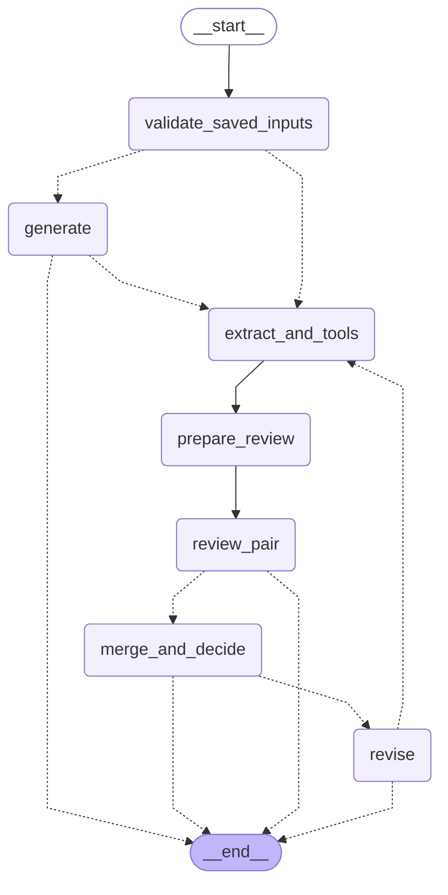
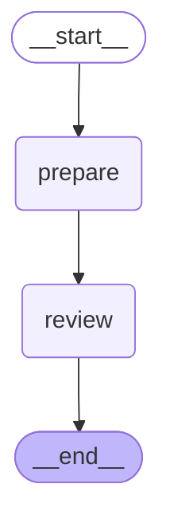

# Optional LangGraph graphs v1

Implementation commit: `9f0e491ad41e8b1beb4d2d9bd45eff2755163d4c`. Generated locally from the compiled graph structures; no remote image renderer or live model.

## Business Harness: seven shared stages

## Separate reviewer component: prepare and review

