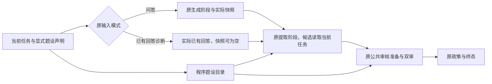

# B语义候选：题设依据接线与完整Harness离线验证

2026-10-22。基点`900db09c1a2147a174562656f07e7f26ed2e9faa`，开始时工作区干净。**候选已实现并贯通离线，不代表真实模型语义问题已解决。生产仍为原schema13、原生成器、原顺序路径和原政策。** 本轮没有真实调用、旧响应回放、依赖安装、A恢复或新付费实验。

用户已接受上轮[最小边界规格与计数修复](../public-review-boundaries-v1/README.md)，明确本轮直接实现语义候选；纠正计数与语义能力继续独立记录。[小型身份/验证清单](results-v1.json)列实际源码哈希、检查及保留事项。

## 实际改动

|层面|实现与边界|
|---|---|
|当前任务题设|`PremiseTaskRequest`显式携带`PremiseDeclaration(source_field, quote, kind)`；仅允许当前question/user_context唯一原文子串、stipulated/unverified_report。`services/task_premises_v1.catalog`计算范围、版本及稳定ID，绑定task_id、scenario_id、问题、上下文和工程上下文哈希；模式/答案不参与，确保两种输入共用身份|
|提取|可选`PremiseClaimExtractor.extract_for_task`拿当前任务和同一目录，仍一次初始请求＋最多一次纠正。模型选既有anchor/premise ID，不能数字符位置。分类为literature、premise_restatement、scenario_application、external_claim、uncertain或ordinary；保留原角色、义务及组件|
|独立依据|`TaskPremiseBasis(type=task_premise_reference, premise_reference=...)`是独立类型，不是Evidence或generation snapshot；模型只返type/premise_id，程序绑定完整原文与版本。依据原型不能夹带Evidence、快照、答案原文或计算字段|
|规则应用|候选解析与核心校验要求definitive应用同时选择本组件登记的全部stipulated题设及技术正文。缺任一不能返supported/contradicted；可合法返insufficient_evidence/not_assessable，保持原因。当前候选不把unverified_report自动升级为可据以确认应用的事实|
|文献/现场边界|普通技术正文、原引用、元数据、快照、计算和实际工程前提的原门禁保留；题设依据不得支持外部现场断言。真实记录的相关性/充分性仍由原事实与领域审核判断，不把程序身份检查冒充真实性认证|
|输出与保存|新增`PremiseBoundClaim`、`PremiseVerificationOutput`保存对象、题设选择及目录；核心类型白名单显式登记。Harness对候选返回目录再次用当前任务重算核对。数据可按dataclass转JSON，不迁移旧记录，不接新API/UI入口|

开发选择只需向**原OfflineHarness**显式注入`PremiseClaimExtractor`和`PremiseVerificationAgent`，并用当前任务的显式题设声明。后者仍schema13、复用原按作用域请求/原引用循环、WireIsolation、解析纠正、双审、政策、trace与预算；候选提示身份`evidence-verification-v9.21-task-premise-boundary-v1-dev`，契约`public-review-premise-boundary-v1-dev`。未另建调度器，也未把独立v7评测组件接入生产。

图示是数据关系，未增加Harness/LangGraph阶段或规划请求。领域审核没有新提示/规则；只让既有“显式义务契约”的能力识别涵盖经验证的候选类型，避免因新版本标识而把概念题退回旧的现场前提检查。旧v7类型的行为不变。

题设重述使用新task_premise目标及input_provided义务；保留旧input_evidence_coverage类别用于输入陈述的结构兼容。新解析内部复用旧v7的锚点/组成项形状校验，返回前恢复显式新目标；**没有生成快照、没有把题设变成Evidence、也没有放行旧快照依据**。普通input_snapshot目标仍需要真实完整生成快照。

## 模型判断与程序门禁分开

模型负责对象分类、原句/规范命题是否忠实、题设是否适用于该规则、正文是否支持结论、必要条件及许可强度是否保留。分类不同意时保留semantic_review的disputed/uncertain，经原有效处置投影为需复核，不自动重标以取得支持。

程序负责唯一定位、版本、ID/任务/组件范围、依据类型组合、必需字段/理由、同伴隔离及聚合。题设重述supported只指“忠实报告给定前提”，不是实地测量成立；应用supported的范围只到该假设场景。不增加“全部正确”等派生模型字段。覆盖仍未接政策，本轮不新增覆盖分母或“已覆盖就通过”。

混合句可以是一条claim的多个组件，也可由多条claim共享原锚点；不同对象与支持状态分别保留，聚合沿原规则，不挑支持子句代表全句。未表述的遗漏不能生成虚拟支持命题；非断言和未覆盖文本仍沿原提取/政策检查。新增断言不会因未登记到题设或生成映射而脱离全文审核。

## 完整Harness与差分证据

所有专项均使用**新教学合成材料**：假定分值42，规则“至少42时允许省略O”；没有读取或重跑GEC/NWS旧任务。真实生成/提取/事实/领域类均接脚本适配器，修订预算0，执行仍由原Harness；替身给出的支持判断不是模型成绩。

- 问答：原生成1、提取1、独立事实1、原引用1、领域1，共5个替身请求；诊断输入无生成快照，共4个，题设目录相同。没有规划或额外分类请求。
- 普通文献题：原提取/原schema13与候选完整Harness对照，答案、命题、支持标签、领域结果、政策及调用数一致；新对象元数据/提示/契约差异明确保留，不称所有消息逐字相同。
- 同一候选的顺序/可选图路径：消息、答案、提取、判断、政策和终态一致，默认仍顺序。
- 反例：正文或题设缺一、跨任务ID、假版本、现场断言借题设、原引用借题设、未核实报告支持应用、旧快照替正文均被拒。合法不足不是执行失败；分类争议不是自动支持。
- 混合组件、必要条件投影、有效同伴/领域结果保留、超时、共享预算、保存失败和取消有专项。取消沿原语义保存已完成同伴的阶段事件，终态domain_output不保证已经赋值；未更改旧取消策略。

**反向限制检查也保留：** 特意让替身在题设41、答案42时仍返faithful/supported；合法ID及类型组合可通过、旧政策甚至可pass。这是测试要展示的剩余语义风险，不是候选的成功样本。没有程序按数值关键词自动改标签，后续必须用新真实运行验证模型能否发现此类错误。

专项25项通过（5.577秒的末轮专项）；中途相关96项通过（7.585秒，当时含16项新专项）。因涉及公共类型/核心校验，另执行一次完整离线回归，**1081项全部通过，140.552秒**。全套含既有批次入口的假响应门禁，未运行旧真实实验或加载旧响应回放，不生成新旧题预测成绩。最终身份见机器清单。

全套后补清候选提取器构造元数据：显式固定protocol_version=7、typed_components=True及daily_guidance=True，避免继承的旧默认属性与其实际v7解析不一致；消息/解析路径不变。最终重核25候选＋8计数共33项通过（6.135秒），未重复全套。

## 纠正计数单独记录

候选构造明确默认`correction_accounting=invocation_scoped_v1`；可在开发对照显式选择shared_slice_v1。原生产构造仍shared_slice_v1。复用上轮按invocation/component/answer_version/prompt筛选；独立事实＋全部原引用仍共享最多一次纠正，整个Harness仍共用原总预算。

无纠正场景下两种计数模式的消息、调用和政策一致；既有8项计数专项继续检查领域/其他事实调用串账、恢复合法纠正、总预算拦截和取消。恢复一次合法纠正可能多一次请求，不称省调用，不用计数测试证明语义准确性。本轮没有实际token、费用或模型等待收益。

## 失败与验证边界

开发中保留五类问题：候选指令插入时机错误导致局部变量未初始化；新语义版本未被原领域义务能力识别；完全无效JSON后初始占位来源应为execution_incomplete；混合夹具声称证据充分却未给生成所需引用；取消夹具错误期待终态已合并同伴字段。前三项在候选接线修复，后两项修正测试以遵守旧生成/取消契约，未放宽生产校验。初始失败与后续通过不冒充真实模型失败/改善。

实际原始输入/响应、官方资料和A的attempt均未改。新离线日志留忽略目录`data/evaluation_local/public-review-premise-v1/offline-checks-v1/`；公开只保留短报告与小清单，不复制源码/数据库/模型或制作ZIP。

回退就是不注入两个候选类、继续原输入/提取/审核；没有图失败自动回退、失败重发或候选无效答案放行。未改服务配置、原政策、生产生成/审核提示、检索或UI，不切schema14，不新增生产路径开关。

本轮完成的是**候选实现、完整Harness离线贯通与差分**。下一步可以另冻结新任务/新运行，验证真实对象分类和依据使用；需独立费用授权和预算/停止门禁。本轮不自动执行，也不恢复A批次。
