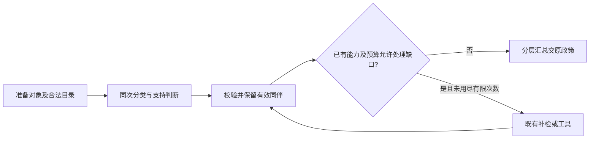

# 事实审核内部流程候选 v1：初始草案与后续实现

2026-10-23续作：此草案保留为设计过程。已实现的候选、最终节点与验证见[完整交付](evaluation/fact-internal-flow-v1/README.md)。原草案“全部登记题设”表述应精确理解为当前组件由提取器选定的题设集合，不能解释为整个任务目录。下方未实施状态仅为首轮历史记录。

起始 HEAD：efbc2840938f26ac006b88a098d5214ba9e69f8e；git status --short 为空。
仅完成初步源码与交接读取，尚未完成服务及实际默认配置核对。无模型调用。

## 初步职责与节点

准备对象（程序）：接收当前回答/版本/主张/题设/实际 Evidence，使用已有验证及绑定，生成局部合法目标与依据目录。

审核义务与支持（模型，同次执行优先）：独立返回对象分类、分类异议、原文忠实性、依据选择和完整命题支持。规则复述不因同段有题设而成为应用；算术比较与工程关系独立分类。分类异议不得复用 fidelity，不静默改写提取对象。

校验与缺口（程序）：严格校验目录成员、作用域、条件及依据义务；沿用适配器预算/超时/有限纠正。补检仅复用现有能力，不能用搜索直到通过。有效同伴、结构失败、对象异议分别保存。原引用继续独立范围。

汇总（程序）：投影原政策能理解的输出；无法无损表达的异议保守保留待复核，不自行放行。修订后沿用完整重提取和重审。

该图为职责草案，尚非可执行图。新增调用应由真实依赖决定：只有支持判断需要此前未交付的合法依据时才有理由增加；分类和支持字段分离不意味着必须分两次请求。

## 已定位问题与待办

services/premise_review_protocol_v1.py 的 validate_selected 对 scenario_application 的确定判断同时要求全部登记题设及 text_excerpt。它将提取分类绑定到依据义务，无法单靠提示解决纯数值比较。
agents/premise_verification_v2.py 只选择新 profile；不是内部流程子图。
harness/graph_runtime_v1.py 是七阶段外层编排，不能冒充本次内部流程重构。

待完成：完整源码审计、新独立候选协议与可注入子图、主题回归、全套离线测试、真实固定输入对照材料、学习站20章60题同步、普通提交推送及远端核对。尚无实现或验证成绩，不请求追加实施授权。
