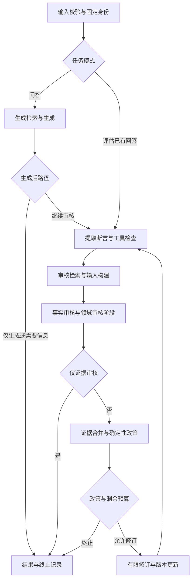

# LangGraph迁移方案v1：先保留行为，再替换流程表达

2026-10-22。状态：**方案已整理，待用户确认；尚未实现或执行迁移**。依据代码提交`9628c53893ee5add5cf5902c733d8e617b76fa0c`，文件身份见[只读核对清单](langgraph-migration-plan-v1.json)。本轮只新增文档，不安装依赖、不改提示、不运行模型或旧实验。

## 目标与范围

目标是让步骤、分支、状态归属和终止路径更清楚，并保持现有执行约束。迁移本身不改善模型语义判断。本方案不新增能力百分比门槛，也不要求模型把旧题答到全对。

保留四Agent、Extractor、Retriever/Evidence、原审核政策及严格契约。第一版只提供开发环境下的可选图执行路径，生产继续使用原路径。暂不引入持久化断点恢复、自动重试、跨运行记忆、Agent Server、云追踪或新数据库。

有两条必须分别验证的路径：

|路径|当前实现|迁移验证能说明什么|
|---|---|---|
|业务问答与审核流程|`OfflineHarness`组织生成、提取、双审、政策与有限修订|用同一组离线替身检查控制流、证据、版本、预算、终止和审计行为是否保留|
|v7评审组件评测|独立`reviewer_baseline_trial_v1`，v7提示、v6解析、`structured_request`与`run_fixed`|检查评测组件的输入、消息、解析、纠正、预算及结果处理是否因图包装变化|

v7不是当前生产事实审核Agent，24份回答也没有经过整个四Agent闭环。因此组件基线不能替代业务全流程回归，更不能用迁移为由把v7接入生产。

## 只读代码核对结果

|位置|已核实行为|设计处理|
|---|---|---|
|[Harness运行器](../harness/runtime.py)、[状态表](../harness/states.py)|现有`run/cancel`、合法状态转换、多个终态；总预算、超时、观察者和结果组装在同一运行范围内|继续由同一个`OfflineHarness`拥有运行生命周期；图替换内部流程表达|
|[Harness契约](../harness/contracts.py)|`HarnessResult`及`ToolHarnessResult`、冻结数据对象、`generation_only/evidence_only`等参数|保留公开签名和输出类型，不把图内部字典直接暴露给API|
|[组装入口](../backend/assembly.py)|构造四Agent、Extractor、工具、Retriever与政策；存在主体补检和不同执行profile|复用组装结果，不重新创建同名业务组件或改变默认profile|
|[后台服务](../backend/service.py)、[存储](../backend/store.py)|服务单worker排队；`recover`将未完运行记为interrupted，不自动入队|队列、取消、观察者和唯一持久化入口保持原职责；图不再建立任务队列|
|[模型运行层](../model_adapter/runtime.py)、[结构请求](../services/structured_model.py)|共享`ModelBudget`与调用归属；严格解析和有界格式纠正在既有层处理|图不另设重试、纠正或每节点独立预算|
|[批次入口](../evaluation/reviewer_baseline_trial_v1.py)、[批次控制](../evaluation/batch_control.py)|24项顺序控制、首最终失败停止；原入口有attempt锁、历史冻结SHA|旧入口与目录封存；未来回归另立版本和授权，不对旧锁做恢复|

现有解释器为Python 3.13.2；包元数据检查显示`langgraph`和`langchain-core`均未安装。当前依赖文件没有给出可复用的LangGraph锁定版本。本轮不安装；确认实施后先在现有解释器核对兼容版本、传递依赖及原依赖影响，独立锁定版本与依赖清单，再做离线试验，不使用浮动升级命令作为项目规格。

**已有规则与代码差异：** [AGENTS.md](../AGENTS.md)写“真实服务事实审核必须显式启用schema12”，但`ServiceConfig`默认13且只接受13/14，组装按该值选择协议。这里分别记录要求和事实，不把“运行中的配置”当作已核实，也不擅改成12或14。第一版离线迁移不触发真实服务；进入真实服务集成前需用户明确适用要求并单独版本化处理，不能借迁移顺便改审核协议。

## 接口与复用方式

保留`OfflineHarness.run(request, budget, *, knowledge_version, generation_only, answer_requirements, evidence_only, indexed_reference_ids, generation_snapshot, run_id)`及`cancel(run_id)`的调用方式。

实施时先把现有嵌套阶段逻辑提成共享内部方法和每运行上下文，先验证原执行路径行为不变；之后由`OfflineHarness`内部显式选择旧流程或图流程。候选实现位置可为`harness/graph_v1.py`及共享阶段模块，名称在实现时确定。本轮没有创建这些代码文件。

图节点只调用同一批阶段方法；政策、验证器、检索交付、纠正逻辑不复制进节点。每次运行只选一种执行路径，不能在节点里再调用完整`OfflineHarness.run`，也不能两套流程先后执行。共享阶段抽取造成的源码SHA变化另立迁移版本；不修改旧冻结文件来使其接受新源码。

## 第一版节点与路由

使用`StateGraph`表达顺序和条件路由；首版保持现有双审的并发边界，将双审放在一个阶段节点内部，继续复用现有并发及异常收集方式。暂不拆成两个独立图分支，以免同时引入状态合并与部分失败语义变化。

图中每个阶段都保留超时、取消、执行失败和存储失败出口；图示只展示正常主干。所有业务状态转换仍经过`NORMAL_TRANSITIONS/INTERRUPT_TARGETS`约束，不给终态添加出边。

|拟定节点|复用内容及分支约束|
|---|---|
|validate|在任何Agent执行前校验请求、模式、知识版本、原证据索引及保存的生成快照；错误保持原输入错误语义|
|generate|仅问答模式；保留生成检索、既有查询转换/补检条件、完整证据及生成约束；仅生成终态不得伪装审核通过|
|extract_and_tools|同一回答版本的原Extractor及工具；按版本保留输出，不把旧claims带入新版本|
|prepare_review|保持当前先事实、后领域的有界顺序检索；分别交付证据/绑定/原引用/生成快照；`evidence_only`不执行领域检索|
|review_pair|普通模式沿用双审并发，输入为同一不可变回答及claims；单侧失败保留另一侧成功输出；仅证据模式只执行事实审核|
|merge_and_decide|沿用证据冲突处理、主体补检与受条件控制的再次事实审核、`decide_context/decide`、原引用和执行完整性限制，不新增LLM裁决|
|revise|政策允许且预算充足才调用原Revision；验证版本、变更、证据与快照；修订后回到提取，双审及政策重新执行，不复用旧轮通过结论|
|finish|依原终态组装结果、trace和issues；`HarnessObserverError`保留向外抛出、由服务登记存储失败的路径，不能补造成功结果|

`review_required`是现有业务终态，首版不转换成LangGraph的可恢复`interrupt()`。需要人工信息的结果同样终止并记录，不自动等待后续消息恢复。

## 状态与写入归属

图状态采用明确字段，继续持有既有冻结数据对象；不把整个运行改成不断追加的聊天消息历史。模型消息始终由原构建器按白名单生成。

|字段组|内容|唯一写入规则|
|---|---|---|
|运行身份|run/task ID、模式、协议/执行路径版本、知识版本、输入及快照身份|开始时绑定；节点只读|
|当前回答|answer、active_snapshot、claims/extraction、generation_output|生成或修订更新回答；提取仅写当前版本；快照不匹配版本时沿旧逻辑失效|
|证据|evidence、bindings、原引用、分别交付的v/d输入与检索记录|由原`merge_evidence`和检索验证器合并；不按文本相似度替换ID|
|审核与政策|verification、domain、report、review_rounds、revision_outputs|双审阶段提交独立输出；合并阶段按原顺序校验；历史轮保留，不覆盖旧理由|
|执行结果|RunState、execution_issues、termination_reason、最终result|业务状态由合法转换函数写入；执行问题与证据不足分开|
|审计引用|trace事件、model/tool/retrieval记录或其引用|保留原组件名、版本及因果关系；图运行事件另加命名空间，不替换业务审计|

Agent、客户端、Retriever连接、共享预算、绝对deadline、取消任务、observer及锁放在运行期上下文；首版不序列化、不放入模型消息，也不宣称可从这些对象恢复运行。凭据和请求头不进入图状态、trace或公开清单。

共享预算以既有对象为唯一权威，图状态中的用量只作观测；不能从可覆盖的状态字段重建剩余额度。`ContextVar`能否贯穿图创建的异步任务须用离线替身验证，不能只依赖框架名推断。

首版无双审图分支的并行写入：阶段输出通过明确字段更新，不对全部状态套用通用append reducer。后续若拆分双审节点，必须另版定义合并、成功同伴保留和冲突处理。

## 预算、停止、存储与取消

1. `run_id`注册和删除、总deadline和共享`ModelBudget`仍由一次Harness调用持有；Agent内模型调用归属保留。图超步数限制只是额外工程防护，不代替模型、检索、工具和修订上限。
2. 不配置图层RetryPolicy、节点缓存或自动恢复；格式纠正继续在既有`structured_request`内按选定冻结配置执行。业务预算与原组件批次的48上界分别属于不同运行范围，不能混用。
3. 步超时/总超时、取消、检索失败和契约失败沿原分支处理；不能把超时变成证据不足或空检索，不能把某个reviewer失败变成丢弃两侧输出。
4. `cancel(run_id)`取消真实正在执行的异步任务，并等待现有双审子任务清理；已完成结果保留。服务重启继续登记interrupted、不自动入队，不调用图resume。
5. observer继续是业务阶段落盘入口；存储失败停止，不通过图日志掩盖。图编排不宣称“恰好一次”外部调用，尤其请求已发出但响应/落盘未知时禁止自动补发。
6. 首版不启用checkpointer。以后启用需要单独设计身份、schema版本、外部副作用幂等及未知调用处置，另行授权；当前attempt锁、失败停止和旧目录封存不因此改变。

## 回归如何比较

### 先做离线工程比较

实施后的旧执行路径与图执行路径使用同一冻结请求、假Agent/假模型队列、固定证据快照和预算。优先复用现有测试，再补真正覆盖迁移风险的差分用例；不为文档改动重跑全套测试。

|比较内容|现有测试依据与新增差分关注点|
|---|---|
|两任务模式、修订及终态|`test_harness.py`、`test_product_policy.py`；同一替身输入产生同一政策/版本/终态、相同有效Agent调用次数与轮数|
|仅生成/仅证据审核|`test_local_service.py`及相关Harness用例；跳过的Agent不得执行，不把generated/evidence_reviewed转成pass|
|证据与检索|`test_harness_retrieval.py`；知识版本、purpose交付、原引用、ID冲突、完整正文、配额与成功同伴保留|
|模型归属及纠正|`test_model_trace_attribution.py`、`test_reviewer_baseline_trial_v1.py`；共享预算、invocation、输入白名单和纠正上限；注入超时、非法ID、缺字段/理由，不修补原输出|
|服务与持久化|`test_local_service.py`；取消、observer失败、服务重启interrupted及不再入队；一个请求只执行一次选择的路径|
|输出与审计|结果类型、字段、回答版本、证据关系、issues、理由及消息内容一致；保留原组件事件与因果顺序|

差分时仅规范化新生成的run/event/临时ID、时间戳与耗时，并保持引用关系一致；不可忽略answer/evidence/claim等输入绑定ID、版本、理由、状态、问题或调用次数。双审完成先后可不同，但每侧事件内容及共同依赖顺序必须保持。原始trace完整保留，比较投影另存。

这些是迁移工程行为检查，不是给组件增加“95%正确”等新能力门槛。离线相同说明给定替身下行为一致，不证明真实模型语义稳定。

### 冻结组件基线如何用

基线依据是[整批收尾确认](evaluation/baseline-batch-v1/owner-text-review-closeout-v1.md)：24项最终有效、23首次有效、25调用；覆盖46/51、5分歧；58参考中56可对齐，54标签一致、2分歧，另2无法对齐，66实际判断。原错误支持双分母0/18和0/38、错误拒支持0/38均保留原E定义，不能推导总体安全。

第一步仅离线：在未来明确批准的回放检查中，旧组件调用路径和图包装使用相同响应队列，通过同一v7消息构建、v6严格解析及纠正机制；覆盖历史一次格式纠正，核对原字段、预算和停止行为。回放不发送请求、不删除attempt，也不把回放结果冒称一次新模型生成。

图包装仅围绕一个评审任务，外层仍由既有`run_fixed`提交和收集；不能把24项改为并发图或另外创建批次调度器。组件路径与业务图共享模型/校验基础设施，但不把v7输出硬转成业务Fact审核合同。

若以后需要真实回归，另立入口/冻结/目录并重新获得载荷、费用、顺序、预算、超时和失败停止授权；不调用旧目录`--run`。计划继续使用同一24输入、v7提示/v6解析、原匹配与参考、交错顺序和分项报告。新入口、框架及依赖身份必须另版绑定，不能要求旧preflight忽略新代码SHA。

真实回归的具体调用规模和是否同步运行旧路径对照，在运行计划中一次固定；本方案不授予新调用上限，也不把历史25调用当成未来必然用量。单独新图运行与历史比较仍受服务/采样/时间波动影响；即便有同期对照也不能由小样本证明普遍改善。

逐项报告执行、覆盖混淆、支持混淆、错误支持/错误拒支持、类型与边界、理由、对齐及未执行；保留本批已确认5/2/2作为旧版对照，不能当作期待新模型必然重复的预测标签。新错误支持或关键越界明确记录，原因不确定时不得归功或归罪框架；无法对齐不自动算错，不挑复合项有利子句。不新增总分或主观充分比例门槛。

当前基线用于回归不自动成为新的独立验证集。若后来据其结果调提示/协议，本批与关联来源转后续开发，原冻结成绩仍保留。

## 实施顺序与交付范围

|阶段|交付|进入下一步的依据|
|---|---|---|
|本轮：方案|本文件、代码身份清单、交接/索引/决策|用户审阅；本轮无实现、安装或模型调用|
|第一步实施：共享阶段|从原Harness抽取阶段、上下文与行为差分记录，保留原默认路径|相关旧测试与新增差分通过，阶段抽取没有可解释之外的行为变化|
|第二步实施：离线图|锁定依赖、可选图路径、节点图、状态/取消/失败差分记录；组件单任务图包装|旧接口和预算/停止/证据/政策保持；所有未覆盖分支明确报告，不把局部通过当完整迁移|
|第三步：组件回放与整合审查|离线回放记录、业务流程离线结果分别列出，更新学习手册待补知识清单|身份绑定、纠正、未对齐与原因字段完整；没有额外副作用或调用|
|可选后续：真实回归|另立计划、冻结与明确付费授权后的报告|按原统计口径记录退步及不确定性；真实服务集成前先解决schema要求差异|

任何阶段不默认切换生产。回退选择原执行路径，不重放失败任务、不替换历史输出，不因图失败自动走旧路径再调用模型。已失败或调用状态未知的运行保留原记录，需新授权才有新运行。

## 官方资料与适用限制

2026-10-22核对的官方资料仅用来约束设计，不代表本地已安装、已测试或锁定对应版本：

- [Graph API](https://docs.langchain.com/oss/python/langgraph/graph-api)：节点读状态并返回更新，边控制后继；本方案据此采用显式状态和条件路由，不把框架状态当业务验证器。
- [图API使用指南](https://docs.langchain.com/oss/python/langgraph/use-graph-api)：有并行、循环及重试等配置；本项目首版有意只使用必要控制流，现有业务限制继续生效。
- [Persistence](https://docs.langchain.com/oss/python/langgraph/persistence)：checkpointer是单运行线程状态持久化机制；它与本项目现有审计落盘职责不同，首版不启用。
- [官方Graph API源码文档](https://github.com/langchain-ai/docs/blob/main/src/oss/langgraph/graph-api.mdx)：checkpoint恢复可能重新进入节点；因此当前不将恢复视为免重复付费调用保证。

实现时按实际锁定版本复核接口，优先最小依赖；不照搬官方安装升级、云追踪或自动恢复示例。最终学习手册应在实现后补入实际节点/状态、共享预算、并发失败和组件/全流程验证区别；本轮不重建整本手册或站点。
