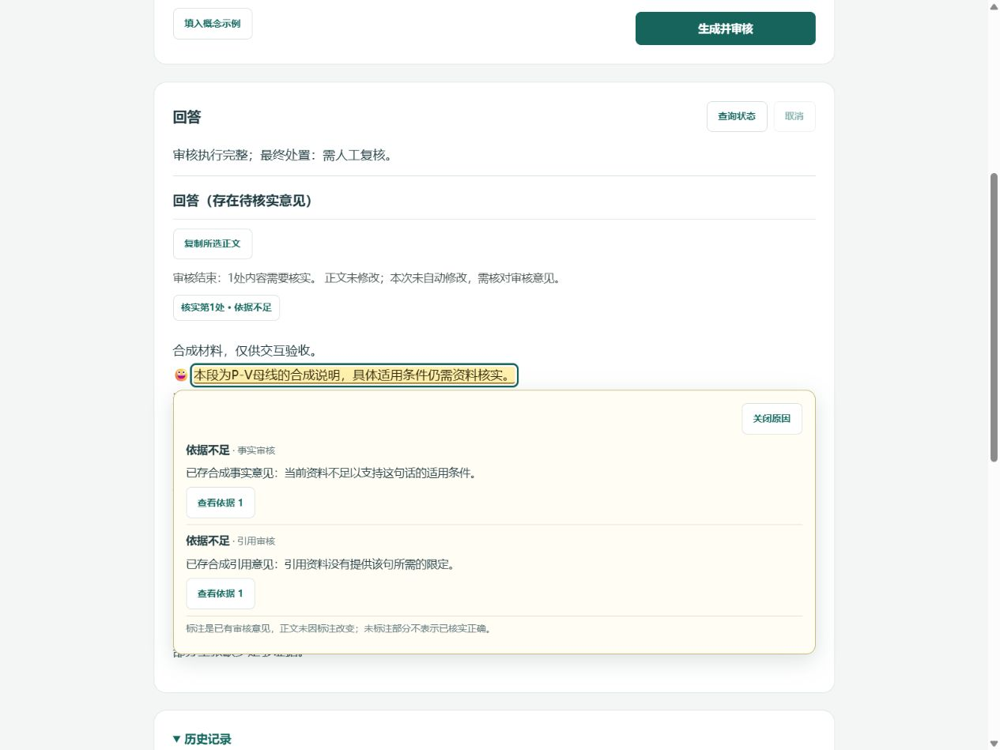

# 正文内审核标注 v7 · 2026-10-27

基于v6最终227bc7ab26c327169a810fa8d3217a33cee4ab24；功能提交d31b477a67e09dac48f715355fc616475eb10ac1。普通分支codex/answer-inline-review-marking-v7，仅本任务，不合并master或重写README。模型请求/token/费用均0；不加载.env、不读取生产运行库、不重跑用户问题、不改模型/检索/审核策略/提示/自动修复/修订资格或预算，不做速度实验。

## 实际行为

正文上方集中说明审核是否结束、多少定位区域待核实、正文是否修改。相同区间的事实和引用意见保留为两条独立意见，共用一个黄色入口；依据不足不称事实错误。与依据冲突采用浅红和“审核判断”标签；无法评估/疑点与执行失败分别说明。无高亮不表示未标部分已正确。

点击标注文字或摘要、键盘聚焦/Enter打开紧邻该处的小卡，显示原有原因、来源及依据按钮；Esc/关闭返回标注。无固定右栏。主页面不再重复整段“未解决句子”，诊断页仍保留原发现/意见。版本/任务切换销毁旧卡，相同身份与区间的刷新可恢复焦点，继续使用原epoch、轮询、反馈及未知POST保护，没有新调度器。

只有保存的实际修订记录对应最终版本且正文确实改变，才说“已有实际修订”；同文版本或未修订明确正文未修改。标注本身不算修订，不根据依据不足臆测系统禁止修订原因，不提供替换句/一键修复/重跑。

## 定位、合并与回退

- backend/answer_annotations.py只读已保存数据。Claim的answer_id/answer_version、原文text、合法offset需共同核对；提取或审核容器明确版本不符时拒绝。旧提取器可从完全同文同版本审核轮次的Claim恢复，重复Claim ID不私取一条。
- 已有offset错误时不搜索兜底。仅缺offset而身份明确、原文逐字且唯一出现，才允许确定性匹配。重复句、改述proposition、缺原文/身份、跨版本均不猜位置。
- 引用意见通过新增review_bindings读取已保存审核输出身份；只在该回答版本的合法引用区间取原文，不借最新版去套历史。缺身份留未定位意见。旧API解释字段、原findings和原unresolved投影继续保留。
- Python区间为Unicode码点，浏览器Array.from后再次核验身份、范围与逐字原文，不归一CRLF/空白。重叠按端点分段，不嵌套mark、不扩展到未覆盖正文；相同/重叠区域计数合并，相邻独立区域不合并。
- 仅审核正常结束且适用阶段完整时显示最终版本标注；审核中/中断/失败草稿不预标。历史显示“未叠加最新版审核标注”，本轮不实现历史逐轮高亮。无锚点任务/工程前提及不安全定位的意见显示“此项未能定位到正文”和原理由，不丢意见。
- 文本通过textContent/文本节点渲染。去掉装饰后的正文逐字等于所选保存版本，复制函数仍直接writeText(shown.text)，不复制标记、编号或解释。标注投影和GET没有存储回写或审核重执行。

## 验证与失败修正

完整离线1374项/406.949秒全部通过。投影/API与前端影响范围20项/5.689秒通过；最终前端/夹具范围18项/4.828秒通过。真实app.js+inline_review.js主DOM探针验证同句两意见/单区间、独立理由、重叠非嵌套、emoji前缀/中文/CRLF、恶意HTML纯文本、错误offset/版本/改述回退、无定位/空答案、审核中/中断、原文和writeText入参逐字相同、历史隔离、关闭焦点与刷新归属。旧主页面/诊断/20异步/26服务状态/12慢辅助/POST/会话保障通过；实际API确认重复GET不改原Store记录、不增加Factory执行、未鉴权仍401。

专项先发现Esc归还焦点会触发重新打开，现归还期间抑制focus展开；实际旧Fake/API提取快照为空时，改从同文同版本审核轮次恢复已存Claim，未放宽身份要求。初次标注演示夹具遗漏前后说明的提取覆盖，被既有校验拒绝；补明确non-claim范围后启动断言通过。冲突/版本例使用原FakeRevision及合法旧提取形态演练已有版本机制，不改生产政策或增加修复能力。失败和修后记录留忽略data/maintenance_local/inline-v7-*，不删除测试或屏蔽失败。

## 实际浏览器与截图

复用正常Factory/Harness/Service/Store的隔离synthetic_fixture：原24条演示及3条正文标注样例，所有位置由实际保存的Claim/Citation生成，未用假DOM伪造定位。浏览器只读取这些隔离历史，不提交用户真实例题。桌面1280×960、390×844（clientWidth=scrollWidth=375）通过：

|样例|观察|
|---|---|
|同句双意见|一个黄色区域、1处计数；就近卡保留事实/引用两来源及独立理由，原文回查可达|
|冲突与已有版本|浅红“与依据存在冲突（审核判断）”；真实Fake保存版本1/2；切1时0个标记且历史警示，切2恢复对应标注及实际修订说明|
|无锚点工程前提|1处已定位意见＋1条未定位摘要，展开可看原任务级原因，不涂整篇|
|交互与窄屏|实际文字点击、Enter/Esc/关闭、键盘选择含标注文字；跨行可读，无整页横溢，无固定右栏|

浏览器工具对跨行mark包围盒中心的点击命中行间空白，按实际文字矩形验证点击后展开，不将自动化空白命中当功能失败。页面按钮回报复制完成，但浏览器工具的剪贴板桥接读回为空，**不把该文案当逐字复制证据**；原文与复制的逐字性由真实客户端DOM及writeText入参探针验证。未读取/宣称用户旧真实例题已正确标注。

[390窄屏卡片截图](../assets/answer-inline-v7-mobile.png)。全部为真实浏览器合成截图，不是模型质量或电力语义正确的证据。

## 学习同步、发布与停止

学习站仅10/14及源码身份：20章88题保持，原14摘录保留，新增identity/locate两份实际AST片段，共16份；构建/源码身份/本地链接通过，并抽查受影响页面。README和默认master维持v6发布边界。

启动合成演示：原项目环境`python -m tools.ui_inline_fixture_v7 --port 8766`，打开`/fixture/connect`后由“历史”选择“正文标注 · 同句双意见”。真实用户服务8765在本轮开始已监听，未停止、重启或占用；仅收尾释放本轮8766/8770。生产库、原判断及原未提交研究/论文/设计材料保持。

最终工作分支正常推送后核对远端ref及关键blob、读取该SHA实际GitHub Actions，不用本地通过代替远端。最终提交自己的CI结果记录在Actions及忽略data/maintenance_local/inline-v7-remote-check.json，避免报告自指产生无限新提交。完成后停止，不追加下一轮任务。
