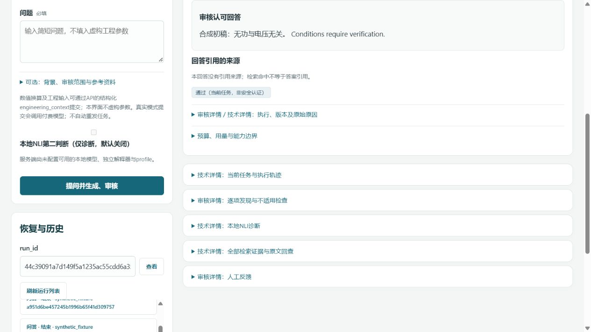
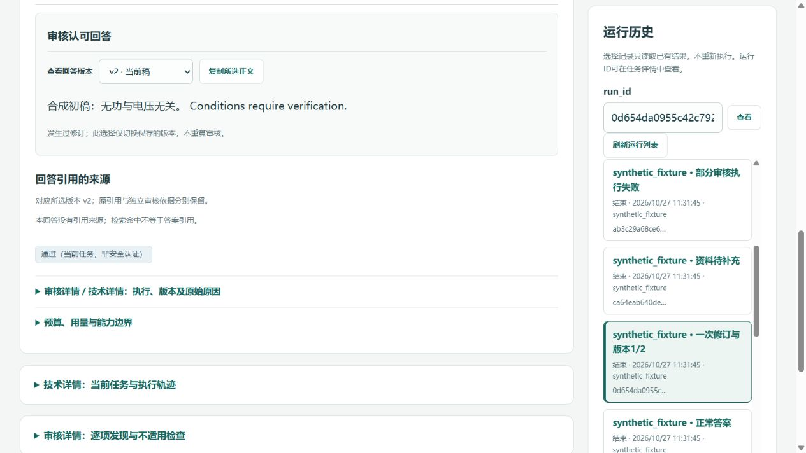
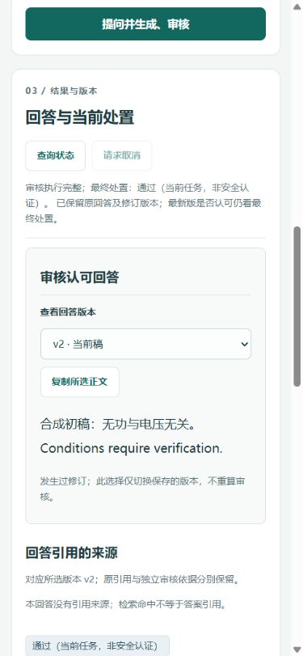

# 业务UI与有限代码维护 · 2026-10-27

基点653412642dc065c39ed6721a64dd55303c45be6b保留。按体验修复→业务UI→依赖审计清理执行，项目模型请求/费用0；不是新能力实验，生成/审核历史成绩不变。生产schema13、受管编排、原检索/默认关闭候选、8765停服及旧库保持。学习站仍独立8770、20章88题，只同步源码身份与维护入口。

## 可感知变化与修前证据

- [实际客户端](../../backend/static/app.js)：可控延迟复现五项修前失败——断连后旧NLI仍写入、读A时不能选择B、旧历史页覆盖新刷新、同令牌重连被旧401注销、只读失败却提示任务可能受理。修后按epoch/请求身份丢弃旧响应及异常，旧finally不释放新查询；可立即切换任务。POST仍不自动重发，受理未知锁定不放宽；取消按钮防重复，反馈回读也检查当前任务。
- [页面](../../backend/static/index.html)与[样式](../../backend/static/style.css)：主问题区加宽，示例只填表不提交；NLI和连接技术细节可达但不抢主流程。结果正文取消强制内层滚动，版本选择与复制放在正文前；v1显示历史稿，当前处置仍针对最新版。没有修订明确写“未发生修订”，取消/执行不完整不伪装成通过。
- 所选版本复制只含该版正文，引用也按该版切换；引用/发现直达[运行作用域Evidence回查](../../backend/static/app.js)，保留原引用/独立依据、来源版本和定位。技术JSON仍在详情，继续textContent安全渲染，没有可信度百分比。
- 历史显示问题摘要、时间、状态及选择态，完整run_id可在详情复制。[RunStore.list_runs](../../backend/store.py)只增加兼容的question_summary字段，压空白后最多120字符；不返回完整请求/配置，不迁移或重写旧记录，旧服务无摘要时前端回退模式名。

五项延迟复现及版本/复制/引用范围由[真实JS离线探针](../../tests/ui_async_probe.js)覆盖，重复提交/受理未知/反馈冲突/恶意文本沿用[客户端检查](../../tests/ui_client_checks.js)。发现该旧探针DOM双缺scrollIntoView，补齐浏览器方法后检查通过，不删除失败测试。修前日志保留忽略data/maintenance_local/product-polish-v1/async-before.log。启动器仅读核对，没有修改真实启动/凭据策略。

## 少量前后图

以下全部来自隔离synthetic_fixture，不是真实模型答案或语义收益。截图只有合成内容和运行ID，无令牌/请求头。

改前：

改后：

390px窄屏：

## 隔离入口及验证

在项目根使用既有环境：`.venv\Scripts\python.exe -m tools.ui_fixture --port 8766`。先访问http://127.0.0.1:8766/看未连接，再访问http://127.0.0.1:8766/fixture/connect进入一次性会话。退出用原终端Ctrl+C。明确synthetic_fixture，临时Store/令牌随本任务进程释放，不复用data/runtime_local，拒绝8765/8770；无from_environment、真实适配器、NLI或70GB入口。[隔离测试](../../tests/test_ui_fixture.py)将环境加载/真实适配器/知识库打开设为失败断言，核对普通鉴权、会话引导、24种子记录与版本/取消/失败结构。这个专用引导只存在于隔离工具，不加入生产API。

浏览器实际覆盖：未连接、正常答案、版本1/2及复制、原文回查、资料不足、执行不完整、装配失败、已取消及实际提交/取消、快速A/B切换、20+4历史分页、追加反馈、恶意script/img字面显示（答案区0个执行节点）、键盘示例/版本/折叠、1280桌面及390窄屏；窄屏client/scroll均375，桌面均1265。示例填入后未自动提交，合成3秒审核延迟只用于取消检查，不是模型性能。中断使临时服务/标签退出后，恢复同一隔离入口完成余项，没有续跑真实批次。无实测模型提速/准确率声明。

专项：阶段1十项4.482秒；阶段2八项9.991秒，另实际客户端6组异步/版本探针及原POST检查通过。沙箱临时目录权限失败后，按AGENTS使用工具审批在原解释器运行；不建环境/改权限。完整unittest最终1337项通过（399.514秒），源码/生产保留见[验证清单](product-polish-ui-code-hygiene-v1-verification.json)，不把测试数当审核能力。初次合成启动的图前置检查未通过；启动入口改为同步核验既有图运行时后成功，没有静默顺序fallback或依赖升级。

## 依赖审计与真实清理

只读代理加主执行核对，限下列目录顶层模块；静态import、动态import_module/配置、CLI、测试和学习站引用形成忽略module-inventory.json，不扫描data/.venv/论文或独立历史仓库。基线266模块，新增隔离工具后267；rg零引用不作死代码证明。

|范围|基线模块数|职责及入口分类|
|---|---:|---|
|agents|24|当前四职责/合同＋可选版本；Factory选择仍有效|
|services|54|协议、作用域、解析/投影；v5/v6及父协议仍有调用|
|backend|14|API/Store/装配/展示；当前必需，http_demo为CLI保留|
|harness|17|生命周期/图/政策/预算；公共异常再导出保留|
|rag|24|检索、身份、索引；默认和候选解析语义不同|
|model_adapter|7|传输/预算/兼容；当前运行必需|
|tools|9|离线CLI与文档构建；本次新增ui_fixture为第10个|
|evaluation|117|冻结实验/回放；99个CLI入口，非日常import不等于无用|

直接清理项：

|位置|删除/合并|依据和验证|
|---|---|---|
|backend/assembly.py、backend/http_demo.py|各一个Path死导入|AST无读取、无项目再导出用途；保留Factory与旧CLI。后者未实际运行以免默认路径污染|
|services/answer_anchors.py|asdict、COMPONENT_CATEGORIES死导入|实际只使用replace/parse_extraction；无外部再导入用途，原锚点规则不变|
|harness/runtime.py|asyncio死导入|调度位于execution，当前生命周期不读取此名；公共异常出口不动|
|backend/static/app.js|未读取的offset状态|分页只读参数page与nextOffset；不合并权限/预算不同的路径|
|前端展示|重复层叠样式重整；证据按钮共用一次运行作用域回查|已包含在UI提交，避免多份回查/同一CSS规则相互覆盖；样式和技术详情功能保留|

没有删除整模块、失败测试、旧标签/合同/记录，也未全仓格式化。以下明确必须留：support_relation_v6复用v5规范化，product_policy/presentation/review_fidelity仍调用v5，v5解析旧标记；fact_flow_protocol_v2继承v1，two_stage继续复用v1/v2；Factory动态注册joint_v2/two_stage_v1仍有效。HarnessObserverError虽本地无读取，却由backend.service和差分测试从runtime再导入；RequiredRetrievalFailure保留兼容出口。evaluation/archive_replay按字段恢复旧dataclass并白名单动态导入，冻结脚本不能按“未采用”删。

topic_lanes/topic_scoring的rank函数体相似，但分别调用不同plan解析，不为四行SQL迁移默认检索。历史PDF构建工具重复收益小，也保留。未知用途列为保留，不声称已无用。

三个可回退源码提交及最终文档身份见[验证清单](product-polish-ui-code-hygiene-v1-verification.json)。封版基点不改，普通分支codex/product-polish-ui-code-hygiene-v1；定向推送并核对远端，不合并/强推。完成后停止工程维护，不重开支持关系语义实验。
