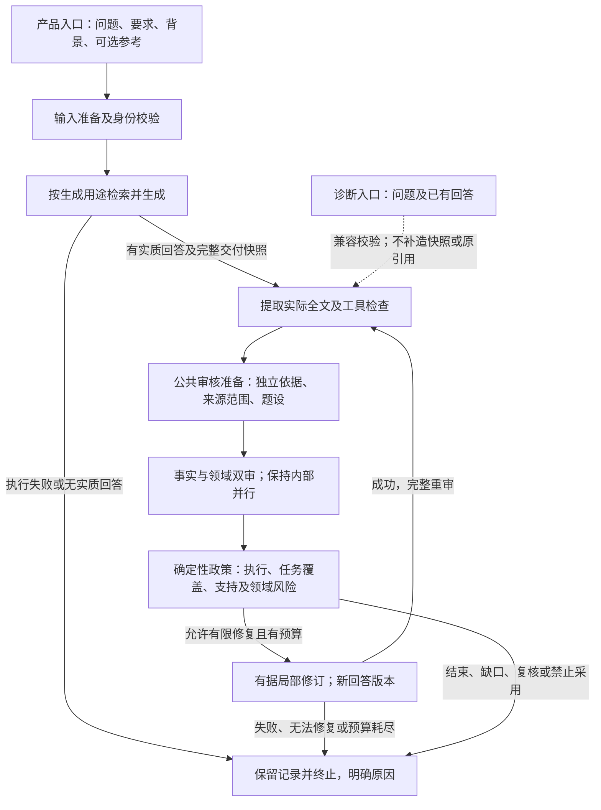

# PowerTrustAI统一业务与判定设计v1

**设计建议，尚未实施。** 2026-10-22；源码基点 `ea4c9f3c5c57a1bf4276cedb1061e804e61b9b9c`。本轮仅源码核对与设计，不改代码、提示、解析器、生产配置，不安装依赖或调用模型。逐文件身份、关键定位及检查范围见[小型机器清单](unified-business-judgment-design-v1.json)。

## 1. 产品范围与当前进度

**“回答＋审核”是唯一面向用户的产品主线**：用户提出问题，系统按证据形成易懂答案，公共审核检查整个实际答案，再给出处置或有限修订。已有回答审核保留为诊断与回归能力，不再是第二条同等优先的产品线。两种输入复用同一个OfflineHarness、四Agent、共享阶段、工具和政策；不删除兼容接口或历史数据。

核对起点HEAD如上，工作区干净，无未提交生成候选需要迁移、删除或重复实现。[生成证据使用方案](concept-evidence-generation-plan-v1.md)已提交，但“必答点—依据—条件”诊断映射尚无独立候选实现。现有生成器已经有条件、因果、简洁和范围提示，不能把这些旧指导当作新候选成果，也不继续零散叠提示。

生产默认的核对限于仓库源码：`ServiceConfig` 默认 real / product-v1 / schema13 / BM25 / aggregate，固定知识版本见 `BASELINE_KNOWLEDGE`，检索执行profile为topic_v4_subject_v1、审核消息profile为lossless_v1；生产工厂未选择图路径。`OfflineHarness` 默认sequential，可选langgraph_v1。服务预算默认40模型调用、1修订轮、800秒总时限、110秒步骤超时、0瞬时重试；不是通用RunBudget类的默认值。环境允许部分覆盖，但本轮未读凭据、环境配置或运行数据库，也未启动服务，**不冒称核实了某个正在运行进程的生效配置**。

[图适配报告](evaluation/langgraph-adapter-v1/README.md)记录7阶段实际路由、1016项历史离线检查、24份历史预测回放及编排开销；本轮未重跑。LangGraph表达流程，不保证语义正确；原路径默认，不新增节点，不切生产图。

## 2. 先收敛入口、状态和验收

|位置|当前源码|最小收敛建议，均未实施|
|---|---|---|
|默认入口|[页面](../backend/static/index.html)的mode选择并列展示问答与已有回答审核；[提交逻辑](../backend/static/app.js)按模式组装同一个POST /runs|默认表单只表达“提问→回答并审核”。已有回答模式移到折叠的“诊断与回归”入口，保留显式进入和模式提示；主入口明确发送question_answer，不把诊断内容误发成生成请求|
|兼容入口|[API Submit](../backend/api.py)保留question_answer / assess_existing及已有引用，校验已有回答与模式匹配|保留字段、路由、鉴权及原校验，不把assess_existing重解释为问答；高级入口不是安全权限边界，无需新后端产品路由|
|运行状态|[服务](../backend/service.py)的queued/running/finished等是持久化生命周期，Harness另有阶段与终态|保留原枚举；增加有版本的展示投影，分清“正在生成”“回答已生成，审核中”“审核结束，有结论或缺口”“审核未完成”。finished不能翻译成已认可|
|结果|页面已优先显示答案、处置、具体未解决句子及来源，另有执行详情|复用现有展示，不重建页面；诊断记录标“诊断／回归”，历史原模式保留，仍可查询、反馈、回查依据，不伪装为产品问答生成结果|
|验收|现有组件基线评审固定回答，不测试从问题生成；已有回答能跳过生成进入共享阶段|产品验收以“问题到回答及完整审核”的链路为主；诊断路径只做共享审核与接口兼容回归，分开计数，不能用其更短耗时或旧组件成绩补足产品验收|

入口收敛不要求立即修改页面。先以本设计确定投影与验收语义，落地放在D；若提前做纯导航调整，必须独立交付，不捎带政策或提示变化。建议保留折叠诊断入口，暂不拆第二页面。切换入口不自动提交、不续跑、不清理历史；旧客户端直接调用兼容API仍有效。

产品计划任务分母覆盖全部提交；分别列出生成失败、无实质回答、产生实质回答、进入审核、完整审核、有限修订及重审、未执行。诊断任务单列。拒答后的审核“不适用”不计作完整审核；审核完成不等于正确或通过。答案出现时间与审核结束时间分别计量，持久化未确认另列，不能因仅有答案就宣告整单成功。

## 3. 一条产品流程，保留一种诊断入口

下图是现有阶段基础上的统一职责设计，不是新增节点实现。公共审核内部包含提取／工具、审核准备与双审。

四Agent仍为生成、事实审核、领域审核、修订；提取是共享服务，不增加第五Agent。共享7阶段仍是validate_saved_inputs、generate、extract_and_tools、prepare_review、review_pair、merge_and_decide、revise；诊断输入跳过generate。覆盖判断的未来接线优先放入既有领域审核的一次请求，另版结果旁录，不增加独立规划或审核节点；是否适合须以离线消息与负载检查验证。

|共用对象／能力|产品路径|诊断与回归差异|
|---|---|---|
|问题、要求、题设、答案版本|保留原问题、显式要求和未核实工程输入；生成新答案|原问题及待评全文必需；缺背景不补造。已有答案不意味着生成过程已知|
|证据和来源|生成前检索及用户参考全部实际交付形成完整快照，记录知识版本、提示及来源角色|原引用仅来自明确提供并校验的绑定；不存在则为空。可以审核无引用答案，不能称其有原引用|
|快照|完整实际交付证据；修订形成新版本实际输入快照|仅在真实保存且身份匹配时使用历史快照；没有则null，后来检索不补成原生成输入。修订后真实产生的新快照不追溯证明原答案生成过程|
|审核与工具|全文提取、标量换算、独立事实依据、原引用核对、领域适用性和安全筛查|同一共享阶段；缺原引用则相关检查不适用，缺快照仅影响依赖该快照的断言，不取消其他事实审核|
|约束与记录|同一预算、取消、超时、observer、版本校验与政策|不设第二Harness、不因诊断身份降低校验；保留旧记录模式和版本，不批量迁移|

## 4. 四层判断：现状、边界和缺口

|层次|当前实现证据|统一设计边界及未实现部分|
|---|---|---|
|任务覆盖|生产[ClaimExtractionOutput](../core/models.py)记录claims/non_claim_spans/uncovered_spans；[提取器](../services/claim_extractor.py)检查实际答案文本，领域审核也判任务适用性。独立[v6定义](../evaluation/premise_bound_review_v6.py)／[v7候选](../evaluation/premise_bound_review_v7.py)才有显式requirement addressedness槽|文本是否被提取审核与问题是否回答是两回事。生产尚无与评测同构、逐要求的独立覆盖输出；不能把uncovered_spans或领域answer_units检查当任务覆盖。领域answer_units主要是数值／单位检查，名称不代表生成答案单元|
|证据支持|VerificationStatus已有四标签；schema13经[事实审核入口](../agents/evidence_verification.py)调用[batched实现](../agents/verification_contract_v10_batched.py)，基于组件、语义忠实性、独立依据与原引用分别处理|supported只限当前命题、依据及条件；contradicted须有冲突依据；insufficient_evidence不是矛盾；not_assessable是实质无法评估，不是超时占位。保留原始模型判断与程序有效处置，不合并成“全正确”字段|
|执行完整性|ExecutionIssue、阶段超时与ModelBudget、双审部分输出、[存储](../backend/store.py)及observer失败处理；服务投影required_stages_complete等|没有合法结果的对象是未完成，不补一个不足标签。服务生命周期、Harness终态、政策execution_integrity和保存确认分别保留。部分有效发现可读，但不能宣告整体已审核|
|处置与风险|[ProductAuditPolicy v1.5](../harness/product_policy.py)计算kind、execution_integrity、risk_level、resolution；危险筛查、工程缺口、原引用、分类异议及有限修订有顺序|继续由程序结合独立层次及领域判断计算，不由模型声明整体通过。当前政策没有逐要求覆盖槽门禁；未来B须另版接入，不能只加覆盖文字却照旧宣称任务完整。pass不是安全认证|

明确说反仍可能covered；遗漏必要内容才partially_covered或missing，确实不清则uncertain。错值、否定或许可强度错误不能机械再扣覆盖；但把所问窄范围替换为另一个对象或宽范围，可能同时真的遗漏必要范围，须具体解释，不从支持标签推覆盖标签。评审理由中的补充解释不能回填答案。

句子的否定、条件、数量、单位、对象、范围、因果方向、may／must均须保留。用户要求“不得无据保证”不自动增加“必须逐句声明没有保证”的义务。没有发生的断言不制造支持性对象：遗漏只对应要求缺口；真正新增的断言即使不属于任何要求，也须支持审核。

生产已有assertion_role、component_basis_targets、component_obligations、task_applicability、来源条件与原文忠实性约束，**不等于**已经实现评测的literature_statement／premise_restatement／scenario_application／external_claim分类。B应对现有对象做版本化适配和不足补齐，不把独立v7契约直接塞进schema13。

## 5. 统一概念契约：复用载体，新增能力单独版本

以下是建议的逻辑对象，不是已生效JSON schema。名字用于说明职责；不要求一轮新增所有字段或强制历史记录补齐。

|对象|来源与关联|模型职责|程序职责及限制|
|---|---|---|---|
|TaskIntent／Requirement|原问题、显式answer_requirements、背景及题设；显式要求由程序分配稳定ID，复合项留组成项|理解隐含子问题、必要条件及边界，给可核对短理由；模糊时保留不确定|绑定task／question hash／要求版本和原文定位；不得以生成自列清单充当独立验收分母。新增隐含项须标模型建议，不能静默升级用户义务|
|AnswerUnit与ClaimComponent|生成单元组装成实际全文；公共提取在实际全文上锚定组件|选择已有锚点，判断命题、立场、范围及语义忠实性|程序组装文本、分配ID、计算位置与版本；单元不等于原子事实。同一句可多组件，重复原文消歧失败须拒绝，不猜位置|
|Evidence／Basis／Premise|Evidence沿用ID、来源版本、知识版本、原文定位；题设独立注册，标stipulated或unverified_report|判断选定依据是否支持该命题，必要条件是否适用；题设应用不冒称现场确认|程序核对选项范围、ID与原文；题设不混成真实现场证据，元数据不替代文献正文。程序存在性校验不证明真实性或支持性|
|GenerationDiagnostic|候选一次生成返回必答点、依据候选、条件与答案unit_index的最小映射|只写简短依据关系和缺口，不生成长推理记录，不重复作整体正确保证|程序绑定task／answer／input hash及本地行ID；依据选程序提供的句段／条件候选ID，答案位置由组装计算。没有候选可用时明确缺口，不要求模型数字符或伪造引用|
|CoverageObservation|原问题与要求→实际答案锚点的多对多关系|covered／partially_covered／missing／uncertain及理由，指出缺哪个组成项|核对要求ID、唯一性、必需条目、原文关联；missing可无锚点。机器验证结构，不能证明覆盖判断正确；状态缺失不补成missing|
|SupportFinding|实际claim／component→选定依据及题设；新增断言也在范围|四类支持标签、限定理由；对象类型、立场与依据匹配独立审查|沿用严格ID／版本／依据索引及有效处置；计数、位置、composition由程序派生，不能证明语义切分正确|
|Execution／Disposition|阶段执行、存储、取消及各独立发现→政策结果|模型不输出派生的“全部正确”“最终允许通过”等字段|程序保留原始状态、计算缺项与政策。风险未知不能以无危险发现填成低风险；保存失败不声称已持久化|
|RevisionAction|finding ID→原缺陷范围、替换片段及依据；关联前后答案版本|提出最小有据修改，逐项modified／retained／unresolved|检查允许依据、ID、版本、变更范围和未解决项；动作记modified不代表问题解决，完整重审才决定新版本处置|

当前 `answer_requirements` 通过API→服务→Harness到GenerationInput；但EvidenceVerificationInput／PowerDomainReviewInput没有独立同名字段，TaskRequest也不含该字段。生成快照可能保存要求，却不是所有路径或所有审核器都有完整快照，不能依赖它补传。B的最小契约变化应将原始要求及独立任务目录显式传到公共审核，两路径一致；生成诊断映射不参与审核消息构造。现有 `assumptions`／`missing_information` 是答案旁录，提取结果明确警示它们不在answer.text的逐主张审核范围；不能把只写在旁录中的必要条件当答案已保留。

任务覆盖与支持是两张关联表，不强行一一对应。一句可回应R1、R2；R3可由三句共同回应；无R关联的附加句仍被审核。要求的组成项事前固定；不能预测后为了好成绩重切。候选只读诊断旁录有自己的版本和身份，不向旧schema3根对象硬塞字段；无旁录的历史版本显示未记录，不补算。

## 6. 公共审核对象、拆合与部分失败

|审核对象|合适依据与处理|不能推出|
|---|---|---|
|文献定义／关系|有直接定义或关系解释的正文及其条件；术语相同、相关公式不足以证明目标关系|不凭空要求厂站核验，也不由一句来源文字推出所有设备普遍成立|
|题设重述|给定假设是否被忠实重述；题设ID、范围明确|题设不是现实测量或独立真实性证明|
|规则应用|文献规则＋适用题设联合检查，包括例外、阈值、许可强度|只复述一般规则不代表已回答显式要求的具体应用；必要条件不扩成充分保证|
|现实设备／现场断言|同对象、同属性、相应时段的记录及必要工程输入；缺资料按实际缺口处理|文献／题设不能证明现场符合、安全或已完成仿真；用户填写工程参数不等于已核实|

混合断言沿原文拆出各组件，分别保留标签、依据、理由和共同锚点；不能仅挑supported组件使整句过关。命题规范化不得强化原文或改立场；分类争议与支持原始判断独立保留，按版本化有效处置进入政策。未知对象／适用性保留不确定，非法ID／缺理由／缺字段则为契约失败，不能自动变成not_assessable。

一个实际句子含S／C或C／I，不强制合成一个新语义标签；若现有报告需要finding聚合，沿当前版本规则并展示明细，不隐藏混合。在评测匹配层，复合参考混合标签或部分等价继续按[原冻结规则](evaluation/baseline-batch-v1/matching-rules-v1.json)未对齐，降低可评价覆盖，不自动算错，不挑有利子句。计数、聚合与语义等价分别报告。

双审一方失败保留另一方已校验输出及实际调用；未返回、未运行、格式失败、超时、取消、存储未确认与语义不足分别记。审核理由与标签冲突保留为问题，不能补造“正确理由”使结果过门禁。图执行失败不自动再走顺序路径；用户重发只能是新的明确运行，不能覆盖原尝试。

## 7. 优化需求、依赖与最小边界

|需求|现状与实际缺口|涉及阶段／文件|共用和路径差异|预期行为、验证与回退|
|---|---|---|---|---|
|A 生成最小映射|已有schema3单元及完整快照、较多提示；没有结构化必答点—依据—条件诊断候选|generate；[generation](../agents/generation.py)、[answer_units](../services/answer_units.py)、[evidence_scope](../services/evidence_scope.py)、[text_location](../services/text_location.py)|只产品生成；诊断路径不伪造映射。原审核仍独立，旧版本不加字段|另版候选一次生成完成映射和答案；程序提供候选ID并定位，映射不是评分分母。固定证据比直接回答、条件、无据附加及成本；关候选回原生成版本，仅对新运行生效|
|B 公共审核边界与覆盖|schema13已有类型／立场／义务与支持关系，领域任务适用性已存在；缺显式原要求传递与独立逐要求覆盖，评测四类对象非生产同构|prepare_review／review_pair／merge_and_decide；[contracts](../agents/contracts.py)、[review_inputs](../services/review_inputs.py)、[task_applicability](../services/task_applicability.py)、事实batched实现、领域审核、产品政策|两种输入共用；诊断无原快照／引用不阻止其余可做检查|先另版旁录覆盖／对象边界，再以明确政策版本接线；遗漏阻止“任务解决完整”，但不制造假断言。验证本文例、复合要求、反向仍覆盖与缺要求传递；不确定或契约不匹配即停，不替换冻结v7或默认schema13|
|C 真正局部修订|已有source-bound repair、finding_actions、最多1轮及完整重审；仍返回整份answer_units，程序校验不证明正确内容／子问题被保留。当前政策还有REPAIRABLE_ERROR分支，并非每次修订都须已有可靠替换原文|revise及重审回环；[revision v2](../agents/revision_contract_v2.py)、[bounded_repair](../services/bounded_repair.py)、[validation](../core/validation.py)、产品政策|公共修订复用；诊断新版本不覆盖用户原答案。修订真实输入可记快照，不补原始快照|先要求可靠替换依据＋可定位缺陷＋可保留的上下文，再提出片段补丁；程序拼接，未改片段逐字保留，仍全文重提取双审。修改权限不足、混合范围无法局部分离、无据或删题则停止并保留缺口；危险禁止采用不得转自动美化|
|D 入口与展示|已有答案优先、未解决原句、风险／处置／执行与历史详情；模式仍同级，尚无逐要求覆盖展示|[index](../backend/static/index.html)、[app](../backend/static/app.js)、[presentation](../backend/presentation.py)、[service result](../backend/service.py)|默认唯一产品入口；诊断入口降级但接口历史不删；共有结果投影保留mode来源|用“已回应但有误／未回应／依据不足／审核未完成”，覆盖不单独涂绿或作采纳标志。原状态可展开；验证早期答案、审核中、混合缺口、失败与诊断历史。仅回退展示投影版本，不重算旧结果|
|性能贯穿A—D|已有单次运行fact_query缓存、知识索引验证缓存／检索复用记录、图结构缓存；无新候选端到端时延数据|[retrieval](../harness/retrieval.py)、生成组装、消息构造与服务事件；ModelBudget不改|共用确定性缓存可以共享算法；生成证据不能成为审核唯一检索范围|缓存键绑定知识／索引／查询／配置／版本及内容身份；不同用途仍有独立scope、绑定、预算和事件。不缓存模型判定，不跨版本复用旧审核。检查开关前后输入／输出相同再测答案出现与审核结束；保留全部证据和审核，不以少答少审换快|

性能优化先测量重复工作的占比，再决定是否缓存。生成本次规划仅本次使用，不持久化成权威问题模板；确定性数据复用不能绕过原证据交付与预算审计。缓存失败可按同一版本原确定性计算执行，不涉及额外模型调用；模型或图失败不得据此重发。

## 8. 分阶段实施与停止条件

本轮不启动以下任何阶段。推荐A→B→C→D；原始要求及身份传播作为A的接口设计约束，A不先改公共审核。入口降级的设计在本轮已固定，无须等待B才确定产品范围；完整覆盖展示必须等待B有真实字段。

|阶段|最小交付与依赖|验收场景与检查|停止条件和回退|
|---|---|---|---|
|A|开发开关下候选生成契约、最小旁录及离线接线；同一生成请求，不增加规划调用；原生产生成与审核均保留|固定证据的定义、条件、多问部分有据及无关附加；合法ID、重复定位、实际快照完整；诊断不入审核消息；未列出的实际断言仍提取。离线替身仅证明工程接线|输出范围／预算不受控、原字段兼容不清、候选迫使改审核器则停在设计／离线阶段。关闭候选即可，不删旧结果；真实效果比较另冻结并新授权|
|B|依赖A稳定的身份边界，但不依赖其诊断作为真值；公共输入显式传要求，领域一次请求增加候选覆盖旁录，事实对象／依据适配；政策接线独立版本|两种输入的相同实际答案得一致审核义务；错误仍回应、真正遗漏、许可、题设与现场、混合／未知／失败；原参考／分母不改。覆盖旁录先观察，不无版本改pass语义|无法区分任务覆盖和审核文本覆盖、必须偷用生成清单作分母、对象强行重分类或预算失控则停；回原审核／政策版本。未启用新覆盖政策的输出明确“不含完整任务覆盖判断”|
|C|依赖B提供稳定缺陷定位、要求和未解决项；局部补丁候选、可靠修复来源、有限修订及全文重审，复用现有Agent|三句正确一句因果扩大仅修一句；保留子问题和条件；修订引入附加断言也检查；无据／危险／超时／第二次请求修订均保留原发现，不宣告解决|源文不能支持替换、补丁有歧义／越界／改掉正确内容、重审不完整则停止。候选新版本保留且不认可，原版本仍可读；禁自动反复修到通过|
|D|复用现有页面，只收敛默认入口与状态／发现投影；依赖B覆盖字段，兼容缺字段历史|主入口只提交question_answer，高级诊断仍assess_existing；历史查询、原引用、反馈兼容；回答先出现未获认可，最终缺口／失败不伪装成功，无绿色covered采纳暗示|若投影掩盖原状态、历史缺字段被补判，或需改数据库迁移则停；回旧页面／投影。保留兼容API，不自动切生产图|

每阶段先离线合同与有针对性的差分，再另行决定有预算的真实验证；不重复整套测试来代替具体问题检查。本轮不设新准确率门槛、扩大题集或付费实验。新协议使用既有材料调试时登记后续开发用途；保留[组件基线原结果及限定确认](evaluation/baseline-batch-v1/owner-text-review-closeout-v1.md)，5覆盖分歧、2支持分歧及56对齐／2未对齐不回写。not_assessable未充分验证，不为凑覆盖硬造标签。

## 9. 教学／合成示例，非新增实验题或参考标签

以下规则和对象全部为合成，仅解释判定逻辑；“支持”均限定于表内资料／假定，不表示现实认证。覆盖按所列问题要求，不按答案正确性判；处置仅示意，最终须由选定政策结合全项计算。

|情形与要求|给定材料／答案|任务覆盖|支持、执行及处置解释|
|---|---|---|---|
|正确且有据：定义标记K|文献：K表示可借阅。答：K表示可借阅|covered|该定义supported；其他必需检查也完成才可评处置，不能仅因covered通过|
|明确错误但已回应：同一定义|答：K表示不可借阅|covered|与明确正文contradicted；可定位错误，不再以错误机械扣覆盖|
|真正遗漏：解释K并说明期限|文献同时给期限7天。答仅解释K|定义covered，期限missing|仅评实际定义supported；没有“期限断言”可判不足，审核理由不能替答案加7天|
|已回应但无证据：更新间隔|资料只给预报时段12小时。答：每6小时更新|covered|insufficient_evidence；时段不能反驳更新间隔。不是自动contradicted|
|必要条件缺失：说明规则及适用条件|文献：仅在模式M下，按键P触发Q。答：按P会触发Q|部分覆盖，缺模式条件|实际无条件泛化缺足够支持；若正文另明确非M不触发，才有相应反驳依据。条件写在评审理由不算答案保留；若答“在非M下触发”则已回应条件但说反，支持另判|
|许可写成强制：说明是否可省略|合成规则明示可省略也可保留。答：必须省略，不可保留|covered|contradicted，明确回应强度但违反保留选项；不能把所有孤立may都自动解释为排除独立强制规则|
|题设应用：S是否需3分钟|假定S海拔7000英尺；规则高于6500需3分钟。答：按给定假设S需3分钟|covered|联合题设及规则supported于假设场景；不证明现实海拔测过。若只复述一般规则则应用要求仍missing|
|缺现场资料：该设备是否满足工况要求|仅有文献，未给设备参数与现场工况。答：资料不足，不能确定该设备满足要求|若只问可否确定则covered；若另要求量化校核则该项未完成|限制句可有答案范围依据；不能凭此给设备事实supported。现场断言若实际出现应判资料不足／无法评估并具体说明，工程输入缺口另列|
|执行失败：答案已生成，事实审核超时|领域输出已合法返回，事实无有效结果|已有覆盖旁录可保留，但不能补全未做判断|execution incomplete；保留有效同级发现，缺失事实项无支持标签，不伪装insufficient_evidence；不认可答案、不自动重发|
|混合与未知：答含两种性质的保证|一句含有据规则重述和无据20年保证；组件边界存在歧义|逐要求独立判断，不因附加句抹掉已回应部分|能忠实拆则分别S／I；不能拆则保留语义异议，不猜原子性。固定复合参考若混合按冻结规则未对齐，不挑S计一致|

## 10. 交付检查与待决定的实质取舍

本轮核对源码、原方案和报告，检查新增文档链接、清单JSON、文件身份与差异；不运行模型、旧回放或全套业务测试，不安装依赖、不读取数据库或凭据。原报告中历史测试数字是引用，不是本轮重验；助手文件SHA机械核对不代表用户验真或语义证明。本轮只新增集中设计、小清单，更新交接与索引；历史文档保留。

最值得先实施的是**A：固定交付证据下的短概念生成候选**，先证明资料已够用时能直接回答并保留条件，审核默认不变。重点取舍是：候选一次生成多输出一份可审计映射，会增加token和格式负担；建议首版保留最小映射并测其开销，不增加规划调用。A是否值得进一步真实比较，由其后离线结果和新的授权决定。

B还有一项必须明确的政策取舍：**真实遗漏是否在新政策中阻断“任务完整／可采纳”，还是先只显示覆盖旁录。** 建议先独立旁录验证边界，再版本化接入阻断；只显示期间不宣称该版本已完成任务覆盖验收。这个决定影响产品处置，不是文案微调。本轮不擅自改变现有pass口径。

入口方案建议采用“单一默认表单＋折叠诊断入口”，无需第二产品页；如用户要求诊断仅限开发脚本，可后续独立取消页面入口，但仍保留兼容API和历史查询。本设计到交付为止，不自动开始A、B、C或D。
